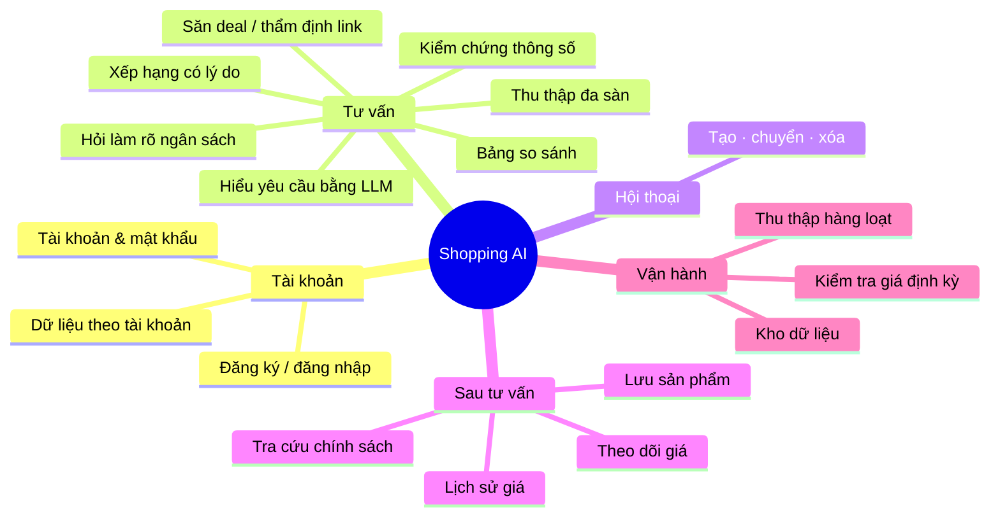
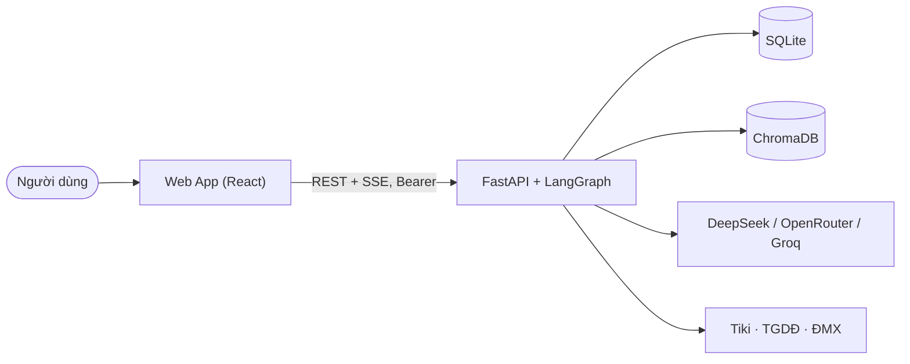

# Shopping AI — Trợ lý mua sắm thông minh (AI Shopping Assistant Agent)

Người dùng mô tả nhu cầu mua sắm bằng ngôn ngữ tự nhiên ("laptop gaming dưới 25 triệu có RTX 4050"). Một **AI Agent** điều phối bằng LangGraph sẽ hiểu yêu cầu, hỏi lại khi còn thiếu thông tin, thu thập sản phẩm thật từ Tiki, Thế Giới Di Động, Điện Máy Xanh, kiểm chứng thông số trên trang chi tiết, xếp hạng có giải thích, so sánh dạng bảng và đưa ra lời khuyên — kèm theo dõi giá, lịch sử giá và dữ liệu cá nhân theo tài khoản.

| Thành phần | Công nghệ | Thư mục |
|---|---|---|
| Backend & Agent | Python 3.11, FastAPI, LangGraph, LangChain, BeautifulSoup, SQLite, ChromaDB | [`backend/`](backend/README.md) |
| Frontend | React 19, TypeScript, Vite 8, Tailwind CSS 4 | `frontend/` |
| Tài liệu | Markdown + Mermaid, OpenAPI 3.1 | [`docs/`](docs/) |

## Chạy nhanh

```bash
# Backend
cd backend
python -m venv .venv && .venv\Scripts\activate      # Linux/macOS: source .venv/bin/activate
pip install -r requirements.txt
copy .env.example .env                               # điền DEEPSEEK_API_KEY / OPENROUTER_API_KEY / GROQ_API_KEY, ADMIN_EMAILS
uvicorn src.main:app --port 8000                     # Swagger: http://localhost:8000/docs

# Frontend (terminal khác)
cd frontend
npm install
npm run dev                                          # http://localhost:3000
```

Mở `http://localhost:3000`, đăng ký tài khoản (email trong `ADMIN_EMAILS` nhận quyền quản trị), rồi vào **Tư vấn mua sắm**.

Kiểm thử: `cd backend && pytest` · `cd frontend && npx tsc --noEmit && npm run i18n:check && npm run build`.

## 1. Yêu cầu — INVEST, use case, tiêu chí nghiệm thu

### 1.1 Sơ đồ tư duy sản phẩm



### 1.2 – 1.4 Tài liệu yêu cầu

| Tài liệu | Nội dung |
|---|---|
| [01-scope.md](docs/01-scope.md) | Vấn đề, mục tiêu V1, ngoài phạm vi, hiện trạng |
| [02-features.md](docs/02-features.md) | 13 tính năng F01–F13 |
| [03-use-cases.md](docs/03-use-cases.md) | Tác nhân, ma trận quyền, 18 use case |
| [08-invest-requirements.md](docs/08-invest-requirements.md) | 18 user story theo INVEST |
| [06-acceptance-criteria.md](docs/06-acceptance-criteria.md) | Tiêu chí nghiệm thu kèm test kiểm chứng |
| [requirements/business-rules.md](docs/requirements/business-rules.md) | 14 quy tắc nghiệp vụ |
| [requirements/non-functional-requirements.md](docs/requirements/non-functional-requirements.md) | Yêu cầu phi chức năng và số đo |

## 2. Kiến trúc thông tin & giao diện

[04-information-architecture.md](docs/04-information-architecture.md): 7 màn hình + 4 hộp thoại, phân cấp, luồng thao tác, trạng thái giao diện, ánh xạ màn hình → API.

## 3. Kiến trúc



| Tài liệu | Nội dung |
|---|---|
| [C4](docs/architecture/c4/README.md) | Bối cảnh, container, thành phần, mã |
| [arc42](docs/architecture/arc42/README.md) | 12 phần: mục tiêu, ràng buộc, chiến lược, thời gian chạy, triển khai, ADR, rủi ro… |
| [UML](docs/architecture/uml/README.md) | Biểu đồ lớp, biểu đồ trình tự |

## 4. Dữ liệu và API

| Tài liệu | Nội dung |
|---|---|
| [05-data-model.md](docs/05-data-model.md), [DATABASE.md](docs/DATABASE.md) | 11 bảng SQLite + ChromaDB, sơ đồ ER |
| [11-rag.md](docs/11-rag.md) | RAG sản phẩm: bge-m3 qua API, BM25 + RRF, chuẩn hóa danh mục, đánh giá recall@k / MRR |
| [api/README.md](docs/api/README.md), [api/openapi.json](docs/api/openapi.json) | 29 operation REST/SSE, sự kiện stream, mã lỗi |

## 5. Cấu trúc thư mục

[07-folder-structure.md](docs/07-folder-structure.md): bố cục backend / frontend, trách nhiệm theo tầng, quy ước đặt tên, biến cấu hình.

## 6. Trạng thái & truy vết

| Tài liệu | Nội dung |
|---|---|
| [09-implementation-status.md](docs/09-implementation-status.md) | Các giai đoạn đã làm, kết quả test, E2E, lộ trình |
| [10-feature-status.md](docs/10-feature-status.md) | Bảng đánh dấu tính năng: đã có / một phần / chưa có |
| [reviews/](docs/reviews/README.md) | Rà soát từng tính năng F01–F13: vấn đề ở đâu, cải thiện gì, thứ tự ưu tiên |
| [traceability/master-traceability.md](docs/traceability/master-traceability.md) | Yêu cầu → use case → tiêu chí → màn hình → thành phần → API → bảng → test |

## Hạn chế chính

Trang danh mục Thế Giới Di Động chỉ lấy được ~20 sản phẩm đầu; Shopee / Lazada tắt mặc định; tra cứu chính sách đổi trả dùng dữ liệu tham khảo; chưa có thông báo email khi đạt giá; chạy một worker. Chi tiết: [arc42 §11](docs/architecture/arc42/11-risks-and-technical-debt.md).
