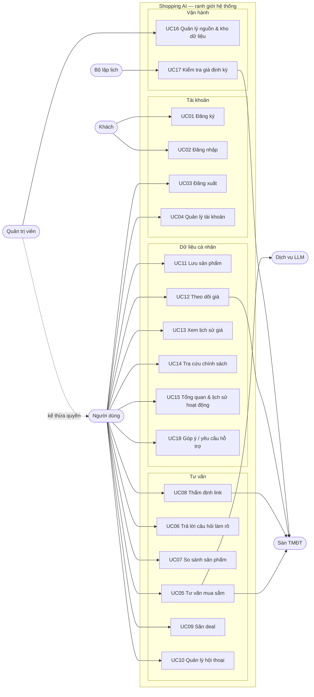
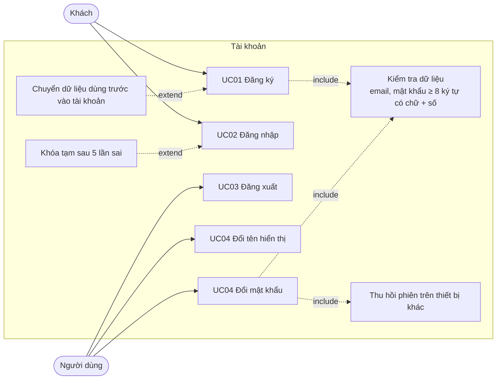
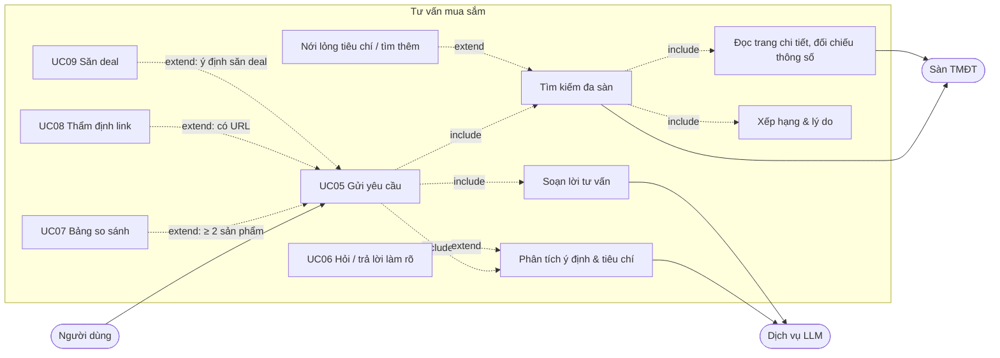
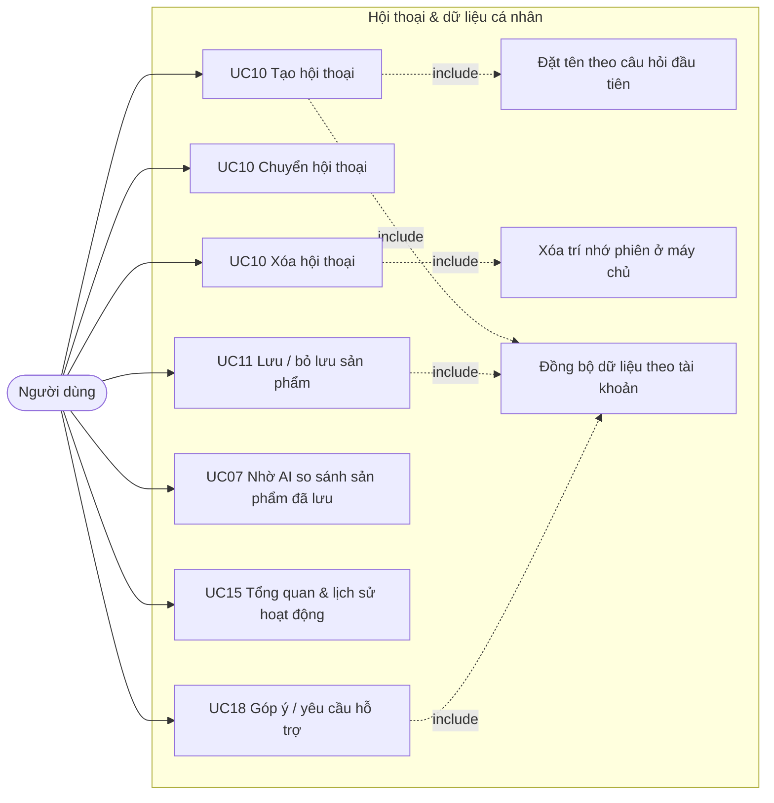
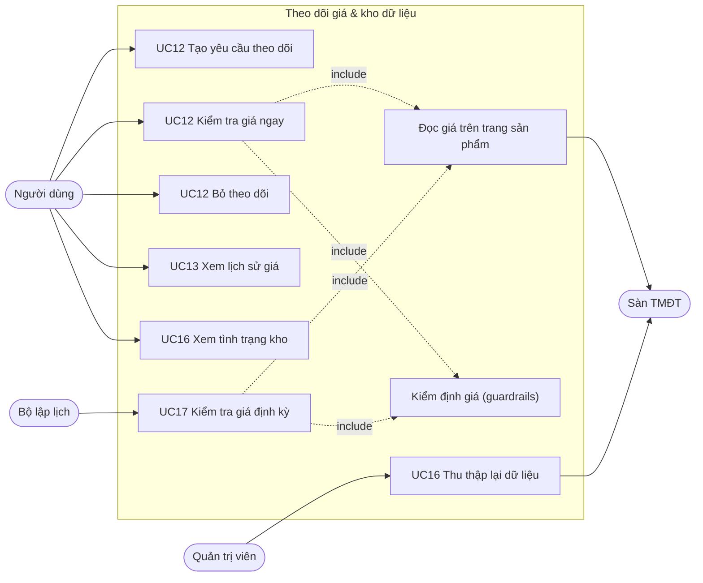

# Tác nhân, vai trò, use case

> Trạng thái thiết kế: V1
>
> Triển khai: đã chạy (UC14 dùng dữ liệu tham khảo)

## Tác nhân / vai trò

| Tác nhân | Giá trị `role` | Mô tả |
|---|---|---|
| Khách | — | Chưa đăng nhập; chỉ thấy màn đăng nhập / đăng ký |
| Người dùng | `user` | Người mua sắm: tư vấn, so sánh, lưu, theo dõi giá, tra cứu |
| Quản trị viên | `admin` | Như Người dùng, thêm quyền kích hoạt thu thập dữ liệu và xem nhật ký guardrails |
| Bộ lập lịch | — | Tác nhân thời gian trong máy chủ: kiểm tra giá định kỳ, làm ấm kho khi khởi động |
| Dịch vụ LLM | — | Hệ thống ngoài: DeepSeek, OpenRouter, Groq |
| Sàn TMĐT | — | Hệ thống ngoài: Tiki, Thế Giới Di Động, Điện Máy Xanh |

## Ma trận vai trò × chức năng

| Chức năng | Khách | Người dùng | Quản trị viên |
|---|---|---|---|
| Đăng ký, đăng nhập | ✓ | | |
| Đăng xuất, tài khoản & mật khẩu | | ✓ | ✓ |
| Tư vấn, hỏi làm rõ, so sánh, săn deal, thẩm định link | | ✓ | ✓ |
| Quản lý hội thoại (của mình) | | ✓ | ✓ |
| Lưu sản phẩm, lịch sử hoạt động (của mình) | | ✓ | ✓ |
| Theo dõi giá (của mình), lịch sử giá | | ✓ | ✓ |
| Tra cứu chính sách | | ✓ | ✓ |
| Xem tình trạng kho dữ liệu | | ✓ | ✓ |
| Kích hoạt thu thập dữ liệu | | | ✓ |
| Xem nhật ký guardrails (`/api/alerts/metrics`) | | | ✓ |

Backend là nơi quyết định quyền: thiếu / sai token → `401`; không đủ vai trò → `403`; truy cập hội thoại của người khác → `403`; yêu cầu theo dõi giá của người khác → `404` (không tiết lộ sự tồn tại).

## Biểu đồ use case

### Quy tắc chung

- Mọi use case trừ UC01, UC02 yêu cầu đăng nhập.
- Dữ liệu cá nhân (hội thoại, đã lưu, lịch sử, theo dõi giá) chỉ chủ sở hữu thấy và sửa được.
- Câu trả lời của trợ lý không được chứa giá / thông số ngoài dữ liệu thu thập ([BR-005](requirements/business-rules.md#br-005--dữ-liệu-trung-thực)).

## Biểu đồ use case phân rã mức 2

### Tài khoản (UC01–UC04)

### Tư vấn mua sắm (UC05–UC09)

### Hội thoại và dữ liệu cá nhân (UC10, UC11, UC15, UC18)

### Theo dõi giá và kho dữ liệu (UC12, UC13, UC16, UC17)

## Bảng use case → sơ đồ

| Use case | Phân rã | Trình tự / hoạt động |
|---|---|---|
| UC01 Đăng ký | Tài khoản | [Trình tự §1](architecture/uml/02-sequence-diagrams.md#1-đăng-ký--post-apiauthregister), [Hoạt động §3](architecture/uml/03-activity-diagrams.md#3-khởi-động-ứng-dụng-và-cổng-đăng-nhập-uc01uc03) |
| UC02 Đăng nhập | Tài khoản | [arc42 §6.1](architecture/arc42/06-runtime-view.md#61-đăng-nhập), [Hoạt động §3](architecture/uml/03-activity-diagrams.md#3-khởi-động-ứng-dụng-và-cổng-đăng-nhập-uc01uc03) |
| UC03 Đăng xuất | Tài khoản | [Trình tự §6](architecture/uml/02-sequence-diagrams.md#6-đăng-xuất--post-apiauthlogout) |
| UC04 Quản lý tài khoản | Tài khoản | [Trình tự §7](architecture/uml/02-sequence-diagrams.md#7-đổi-mật-khẩu--post-apiauthchange-password) |
| UC05 Tư vấn mua sắm | Tư vấn | [Trình tự §2](architecture/uml/02-sequence-diagrams.md#2-tư-vấn-mua-sắm--post-apichatstream), [Hoạt động §1–2](architecture/uml/03-activity-diagrams.md), [đồ thị LangGraph](architecture/arc42/06-runtime-view.md#62-tư-vấn-mua-sắm-đồ-thị-langgraph), [cache-first](architecture/arc42/06-runtime-view.md#63-tìm-kiếm-cache-first) |
| UC06 Trả lời câu hỏi làm rõ | Tư vấn | [Trình tự §3](architecture/uml/02-sequence-diagrams.md#3-hỏi-làm-rõ-qua-hai-lượt) |
| UC07 So sánh sản phẩm | Tư vấn, Hội thoại & dữ liệu | [Trình tự §8](architecture/uml/02-sequence-diagrams.md#8-nhờ-ai-so-sánh-sản-phẩm-đã-lưu--post-apichatcompare) |
| UC08 Thẩm định link | Tư vấn | [Trình tự §9](architecture/uml/02-sequence-diagrams.md#9-thẩm-định-link-sản-phẩm) |
| UC09 Săn deal | Tư vấn | [Trình tự §10](architecture/uml/02-sequence-diagrams.md#10-săn-deal) |
| UC10 Quản lý hội thoại | Hội thoại & dữ liệu | [Trình tự §5 (xóa)](architecture/uml/02-sequence-diagrams.md#5-xóa-hội-thoại--delete-apichathistoryid), [§11 (tạo / chuyển)](architecture/uml/02-sequence-diagrams.md#11-tạo-và-chuyển-hội-thoại) |
| UC11 Lưu sản phẩm | Hội thoại & dữ liệu | [Trình tự §12](architecture/uml/02-sequence-diagrams.md#12-lưu-sản-phẩm-và-đồng-bộ-dữ-liệu-cá-nhân) |
| UC12 Theo dõi giá | Theo dõi giá | [Trình tự §13 (tạo)](architecture/uml/02-sequence-diagrams.md#13-tạo-yêu-cầu-theo-dõi-giá--post-apialerts), [§4 (kiểm tra)](architecture/uml/02-sequence-diagrams.md#4-kiểm-tra-giá--post-apialertscheck) |
| UC13 Xem lịch sử giá | Theo dõi giá | [Trình tự §14](architecture/uml/02-sequence-diagrams.md#14-xem-lịch-sử-giá--get-apiproductsidhistory) |
| UC14 Tra cứu chính sách | — | [Trình tự §15](architecture/uml/02-sequence-diagrams.md#15-tra-cứu-chính-sách-bảo-hành--đổi-trả) |
| UC15 Tổng quan & lịch sử hoạt động | Hội thoại & dữ liệu | [Hoạt động §4](architecture/uml/03-activity-diagrams.md#4-tổng-quan-lịch-sử-hoạt-động-góp-ý-uc15-uc18) |
| UC16 Nguồn & kho dữ liệu | Theo dõi giá & kho | [Trình tự §16](architecture/uml/02-sequence-diagrams.md#16-thu-thập-dữ-liệu-hàng-loạt--post-apicrawlertrigger) |
| UC17 Kiểm tra giá định kỳ | Theo dõi giá & kho | [arc42 §6.4](architecture/arc42/06-runtime-view.md#64-theo-dõi-giá) |
| UC18 Góp ý / hỗ trợ | Hội thoại & dữ liệu | [Hoạt động §4](architecture/uml/03-activity-diagrams.md#4-tổng-quan-lịch-sử-hoạt-động-góp-ý-uc15-uc18) |

## Đặc tả use case

### UC01 Đăng ký

- **Tác nhân:** Khách. **API:** `POST /api/auth/register`. **Màn hình:** SCR-01.
- **Luồng chính:** nhập tên hiển thị, email, mật khẩu, nhập lại mật khẩu → giao diện kiểm tra → máy chủ kiểm tra lại, băm mật khẩu, tạo tài khoản và phiên → vào thẳng ứng dụng.
- **Ngoại lệ:** dữ liệu không hợp lệ → `422` kèm lý do; email đã đăng ký (không phân biệt hoa thường) → `409`.
- **Hậu điều kiện:** tài khoản `user` (hoặc `admin` nếu email thuộc `ADMIN_EMAILS`); dữ liệu dùng trước khi có tài khoản trên trình duyệt được chuyển vào tài khoản.

### UC02 Đăng nhập

- **Tác nhân:** Khách. **API:** `POST /api/auth/login`. **Màn hình:** SCR-01.
- **Luồng chính:** nhập email, mật khẩu → máy chủ xác thực → trả token và hồ sơ → tải dữ liệu cá nhân từ máy chủ.
- **Ngoại lệ:** sai email hoặc mật khẩu → cùng thông báo `401` "Email hoặc mật khẩu không đúng"; sai 5 lần liên tiếp → `429` trong 5 phút.

### UC03 Đăng xuất

- **API:** `POST /api/auth/logout`. Token bị thu hồi ở máy chủ, xóa khỏi trình duyệt, quay về SCR-01. Token hết hạn / bị thu hồi ở bất kỳ lời gọi nào cũng đưa về SCR-01.

### UC04 Quản lý tài khoản

- **API:** `GET/PATCH /api/auth/me`, `POST /api/auth/change-password`. **Màn hình:** DLG-04.
- Đổi tên hiển thị (2–50 ký tự). Đổi mật khẩu cần mật khẩu hiện tại; thành công thì các thiết bị khác bị đăng xuất, phiên hiện tại giữ nguyên.

### UC05 Tư vấn mua sắm

- **Tác nhân:** Người dùng; Dịch vụ LLM, Sàn TMĐT. **API:** `POST /api/chat/stream`. **Màn hình:** SCR-03.
- **Luồng chính:**
  1. Người dùng gửi yêu cầu (VD: "Laptop gaming dưới 25 triệu có RTX 4050").
  2. Hệ thống nạp trí nhớ hội thoại; router LLM phân loại ý định và trích tiêu chí.
  3. Tìm trong cache / RAG; nếu không có thì cào TGDĐ, ĐMX, Tiki song song, lọc ngữ nghĩa.
  4. Đọc trang chi tiết, đối chiếu thông số, chấm điểm, gửi sự kiện `products`.
  5. Dựng bảng so sánh (≥ 2 sản phẩm), gửi `comparison`.
  6. Stream lời tư vấn (`token`), câu hỏi gợi ý (`suggestions`), ghi chú (`done.search_notes`); lưu lượt hội thoại.
- **Luồng thay thế:** yêu cầu chung chung → UC06; không có sản phẩm → nới lỏng tiêu chí và ghi rõ đã nới gì; không sản phẩm nào đúng thông số → tìm thêm tới +20% ngân sách; ngoài phạm vi mua sắm → từ chối lịch sự; mọi LLM lỗi → phân loại từ khóa và câu trả lời dựng sẵn.

### UC06 Trả lời câu hỏi làm rõ

- **Tiền điều kiện:** lượt trước có câu hỏi làm rõ (lưu `conversation_states`).
- Chọn một mức ngân sách hoặc tự gõ → gộp vào tiêu chí đang chờ → tiếp tục UC05 từ bước 3. Chuyển sang ngành hàng khác → bỏ tiêu chí đang chờ. Mỗi ngành hàng hỏi một lần trong hội thoại.

### UC07 So sánh sản phẩm

- Trong chat: bấm "Xem bảng so sánh chi tiết" dưới kết quả. Từ SCR-05: chọn ≥ 2 sản phẩm → "Nhờ AI so sánh" → mở hội thoại mới, gọi `POST /api/chat/compare` (không cào lại).

### UC08 Thẩm định link sản phẩm

- Dán URL vào khung chat (router nhận dạng `parse_link`) hoặc gọi `POST /api/parse-link`. Trả thông tin sản phẩm và lời đánh giá.

### UC09 Săn deal

- Hỏi "săn deal …" hoặc "con nào đang giảm sâu nhất?". Có sản phẩm cụ thể → tìm kiếm; không nêu sản phẩm và có kết quả lượt trước → dùng lại. Xếp theo mức giảm, ghi số tiền tiết kiệm.

### UC10 Quản lý hội thoại

- Tạo: nút "+" → hội thoại được tạo khi gửi câu hỏi đầu tiên, tên = câu hỏi đó. Chuyển: chọn trong danh sách (khóa khi đang chờ trả lời). Xóa: thùng rác → xác nhận tại dòng → `DELETE /api/chat/history/{id}` xóa tin nhắn, ngữ cảnh, trạng thái làm rõ ở máy chủ.

### UC11 Lưu sản phẩm

- "Lưu sản phẩm" trên thẻ / bảng so sánh; bỏ lưu ở SCR-05. Đồng bộ `/api/auth/me/data/saved-products`.

### UC12 Theo dõi giá

- **API:** `POST/GET/DELETE /api/alerts`, `POST /api/alerts/check`. **Màn hình:** DLG-01, SCR-06.
- **Luồng chính:** "Theo dõi giá" trên thẻ → chọn mức giá → lưu (giá mong muốn phải thấp hơn giá hiện tại) → ở SCR-06 bấm "Kiểm tra giá ngay" → đọc giá thật, kiểm định, ghi lịch sử; giá ≤ mục tiêu → "Đã đạt giá mong muốn".
- **Ngoại lệ:** không đọc được giá hiện tại khi tạo → `400`; giá mong muốn ≥ giá hiện tại (server đọc) → `400`; không đọc được giá khi kiểm tra → ghi chú, giữ trạng thái; biến động bất thường → chờ xác nhận ở lần đọc sau; giảm mạnh tới mức mong muốn → đọc lại trước khi báo (BR-011).

### UC13 Xem lịch sử giá

- `GET /api/products/{id}/history` → biểu đồ bậc thang (đường đứt nét = giá mong muốn), tooltip, bảng. Một mốc giá → thông báo "biểu đồ sẽ hiện khi giá thay đổi".

### UC14 Tra cứu chính sách

- Nhập ngành hàng / sản phẩm, chọn các sàn → bảng so sánh chính sách. **Dữ liệu tham khảo.**

### UC15 Tổng quan & lịch sử hoạt động

- SCR-02 tóm tắt hoạt động; SCR-07 liệt kê theo ngày, lọc theo loại, mở lại kết quả trong chat, xóa lịch sử.

### UC16 Quản lý nguồn & kho dữ liệu

- Mọi người dùng: bật/tắt nguồn, xem tình trạng kho (`GET /api/crawler/status`). Quản trị viên: "Thu thập lại dữ liệu ngay" (`POST /api/crawler/trigger`, người dùng thường nhận `403`).

### UC17 Kiểm tra giá định kỳ

- **Tác nhân:** Bộ lập lịch. Mỗi `PRICE_WATCH_INTERVAL_MINUTES` (mặc định 360): kiểm tra mọi yêu cầu `watching` như UC12, ghi nhật ký benchmark. Giao diện thấy kết quả trong lần tải lại danh sách (5 phút một lần) và ghi "Đạt giá mong muốn" vào lịch sử hoạt động.

### UC18 Góp ý / yêu cầu hỗ trợ

- Chọn chủ đề, nhập nội dung (yêu cầu hỗ trợ có thêm thông tin liên hệ) → ghi vào lịch sử hoạt động của tài khoản. Chưa gửi tới máy chủ riêng.
