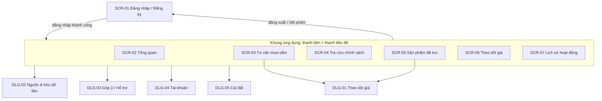
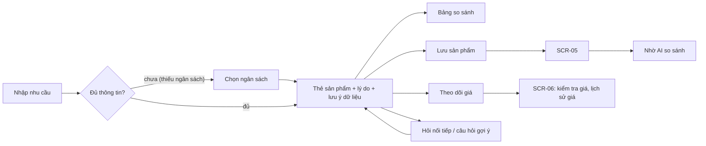
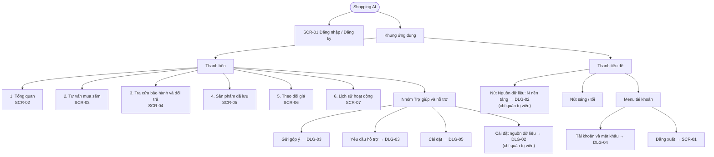
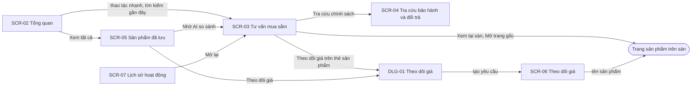
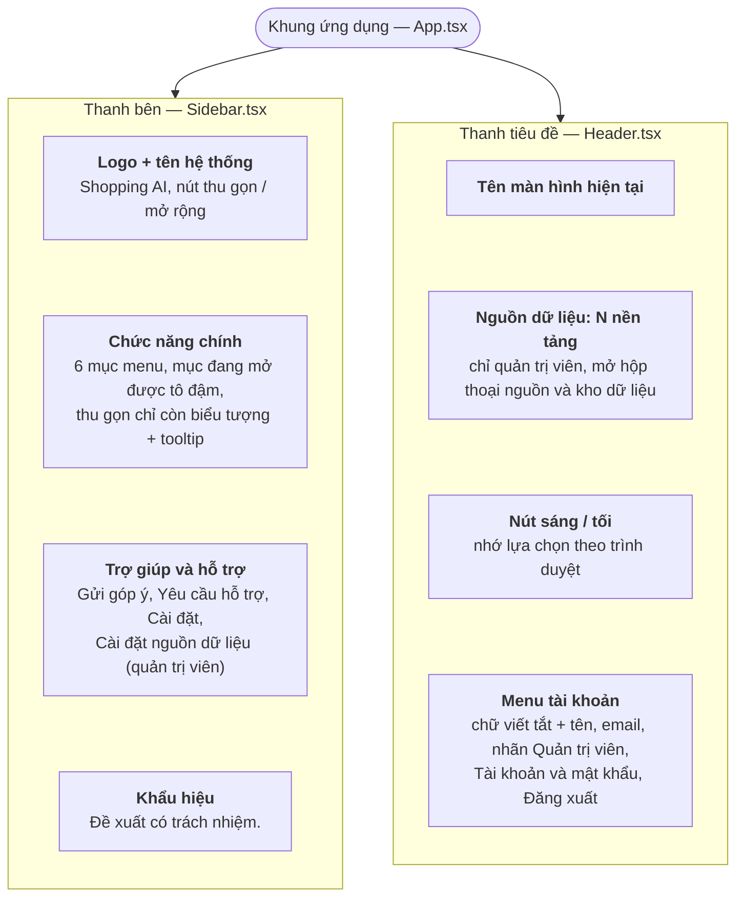
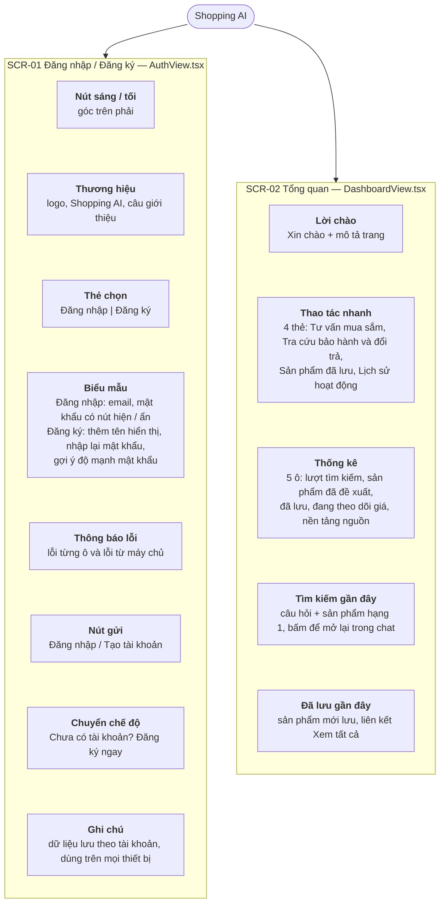
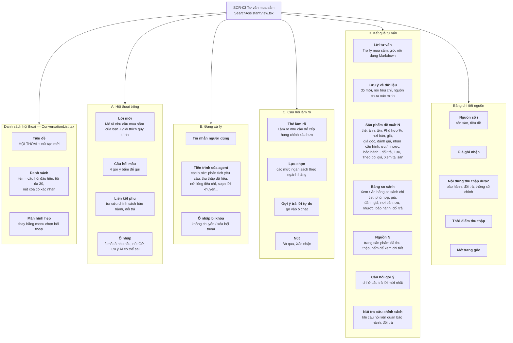
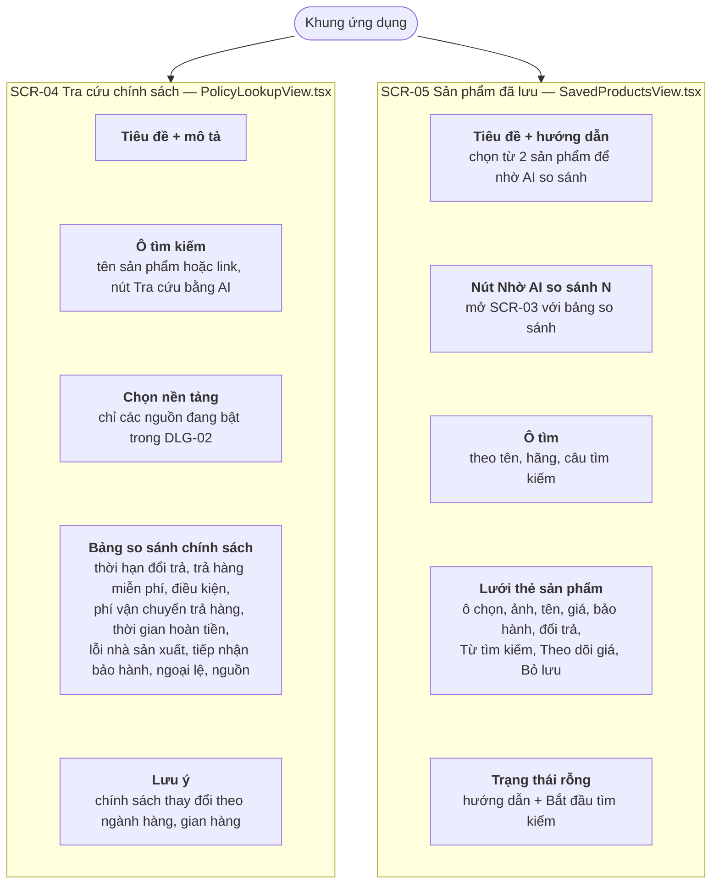
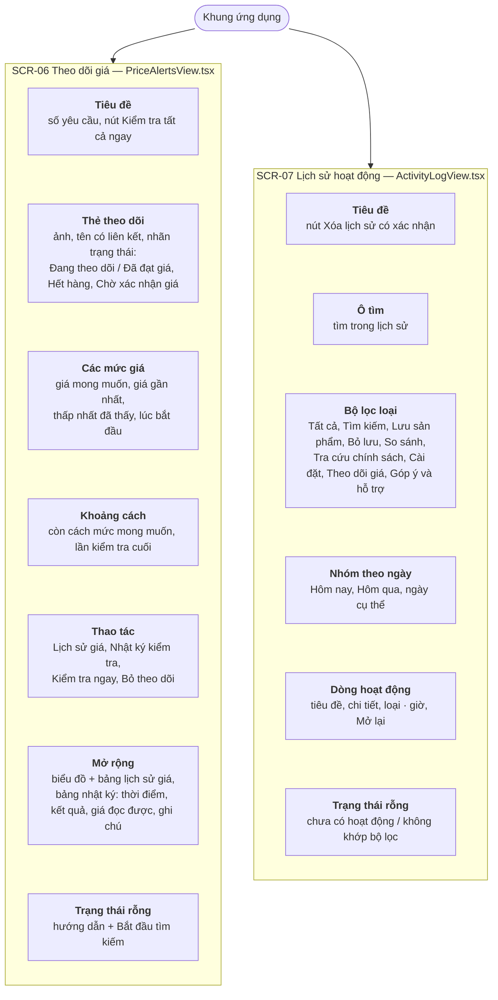
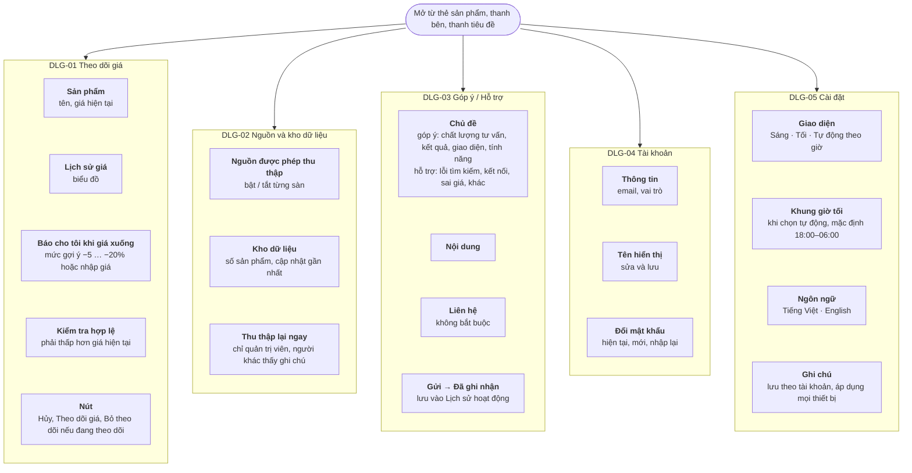

# Kiến trúc thông tin

> Trạng thái: V1 — đã triển khai trong `frontend/src`

## Phân quyền màn hình

| Màn hình | Khách | Người dùng | Quản trị viên |
|---|---|---|---|
| SCR-01 Đăng nhập / Đăng ký | ✓ | | |
| SCR-02 … SCR-07, DLG-01, DLG-03 … DLG-05 | | ✓ | ✓ |
| DLG-02 Nguồn & kho dữ liệu (mục "Cài đặt nguồn dữ liệu", nút "Nguồn dữ liệu" trên thanh tiêu đề) | | ẩn | ✓ |

> Bật / tắt nguồn dữ liệu là cấu hình hệ thống nên chỉ quản trị viên thấy (DLG-02); lựa chọn hiện vẫn chỉ lưu trên trình duyệt, chưa áp dụng ở máy chủ — xem [reviews/F13](reviews/F13-nguon-kho-du-lieu.md) phần A. Người dùng thường có hộp thoại **Cài đặt** (DLG-05) chỉ gồm thiết lập lõi: giao diện (sáng / tối / tự động theo giờ) và ngôn ngữ (Tiếng Việt / English), lưu theo tài khoản.

Chưa đăng nhập thì ứng dụng chỉ hiển thị SCR-01. Đăng xuất hoặc token hết hạn đưa về SCR-01.

## Danh sách màn hình

| ID | Màn hình | Component | Mục đích |
|---|---|---|---|
| SCR-01 | Đăng nhập / Đăng ký | `AuthView.tsx` | Hai thẻ Đăng nhập / Đăng ký, kiểm tra dữ liệu tại chỗ, ẩn/hiện mật khẩu |
| SCR-02 | Tổng quan | `DashboardView.tsx` | Thao tác nhanh, 5 ô thống kê, tìm kiếm & đã lưu gần đây |
| SCR-03 | Tư vấn mua sắm | `SearchAssistantView.tsx`, `ConversationList.tsx` | Danh sách hội thoại + khung chat, tiến trình agent, thẻ sản phẩm, bảng so sánh, câu hỏi làm rõ |
| SCR-04 | Tra cứu bảo hành & đổi trả | `PolicyLookupView.tsx` | So sánh chính sách giữa các sàn (dữ liệu tham khảo) |
| SCR-05 | Sản phẩm đã lưu | `SavedProductsView.tsx` | Danh sách đã lưu, chọn để so sánh, theo dõi giá |
| SCR-06 | Theo dõi giá | `PriceAlertsView.tsx` | Danh sách theo dõi, kiểm tra ngay, lịch sử giá |
| SCR-07 | Lịch sử hoạt động | `ActivityLogView.tsx` | Hoạt động theo ngày, lọc, mở lại trong chat |
| DLG-01 | Hộp thoại Theo dõi giá | `TrackPriceModal.tsx` | Chọn giá mong muốn, xem lịch sử giá |
| DLG-02 | Hộp thoại Nguồn & kho dữ liệu | `SettingsModal.tsx`, `DataWarehousePanel.tsx` | Bật/tắt nguồn, tình trạng kho, thu thập lại (admin) |
| DLG-03 | Hộp thoại Góp ý / Hỗ trợ | `HelpRequestModal.tsx` | Gửi góp ý, yêu cầu hỗ trợ |
| DLG-04 | Hộp thoại Tài khoản | `AccountModal.tsx` | Đổi tên hiển thị, đổi mật khẩu |
| DLG-05 | Hộp thoại Cài đặt | `PreferencesModal.tsx` | Giao diện (sáng / tối / tự động theo giờ), ngôn ngữ (Tiếng Việt / English) |

Khung ứng dụng (`App.tsx`): thanh bên (`Sidebar.tsx`, thu gọn được), thanh tiêu đề (`Header.tsx`: tên màn hình, nút nguồn dữ liệu, nút sáng/tối, menu tài khoản).

## Phân cấp màn hình



## Luồng thao tác chính



## Sơ đồ điều hướng (sitemap)

Mục trên thanh bên theo đúng thứ tự hiển thị, từ trái sang phải.



Liên kết chéo giữa các màn hình (nút, liên kết trong nội dung):



Trạng thái rỗng của SCR-05, SCR-06, SCR-07 và trang Tổng quan đều có nút **Bắt đầu tìm kiếm** dẫn về SCR-03.

## Nội dung từng màn hình (sitemap chi tiết)

Mỗi cột là một màn hình, các khối xếp theo thứ tự từ trên xuống như trên giao diện, kèm mô tả ngắn nội dung.

### Thành phần dùng chung

Có mặt trên mọi màn hình SCR-02 → SCR-07; SCR-01 chỉ có nút sáng / tối.



### SCR-01 Đăng nhập / Đăng ký và SCR-02 Tổng quan



### SCR-03 Tư vấn mua sắm

Màn hình chính có bốn chế độ xem con theo tiến trình một lượt tư vấn.



### SCR-04 Tra cứu bảo hành và đổi trả, SCR-05 Sản phẩm đã lưu



### SCR-06 Theo dõi giá, SCR-07 Lịch sử hoạt động



### Hộp thoại



## Wireframe

Bố cục phác thảo của các màn hình chính (màn hình rộng).

**Khung ứng dụng + SCR-03 Tư vấn mua sắm (kết quả)**

```text
┌──────────────┬───────────────────────────────────────────────────────────────────┐
│ ◆ Shopping AI│ Tư vấn mua sắm        [Nguồn dữ liệu: 3 nền tảng] [☾] │ (NV) Tên ▾ │
│──────────────├──────────────┬────────────────────────────────────────────────────┤
│ ▣ Tổng quan  │ HỘI THOẠI  + │  Bạn: Laptop gaming dưới 25 triệu có RTX 4050      │
│ ▣ Tư vấn ◀   │──────────────│                                                    │
│ ▣ Tra cứu    │ ▸ Laptop ... │  Trợ lý mua sắm · 14:02                            │
│ ▣ Đã lưu     │   Máy giặt ..│  Lời tư vấn (Markdown) ...                         │
│ ▣ Theo dõi   │   Tai nghe ..│  ┌ ⚠ Lưu ý về dữ liệu ────────────────────────┐   │
│ ▣ Lịch sử    │              │  └────────────────────────────────────────────┘   │
│              │              │  Sản phẩm đề xuất (3)                              │
│ TRỢ GIÚP     │              │  ┌──────┬───────────────────────────────────────┐ │
│ ✎ Góp ý      │              │  │ ảnh  │ Tên sản phẩm      Phù hợp 86%          │ │
│ ⛑ Hỗ trợ     │              │  │      │ Nơi bán · sàn  24.990.000 ₫ ̶2̶7̶.̶9̶9̶0̶...│ │
│ ⚙ Nguồn      │              │  │      │ [Đúng cấu hình] + ưu | − nhược         │ │
│              │              │  │      │ [Lưu] [Theo dõi giá] Xem tại sàn ↗     │ │
│ Đề xuất có   │              │  └──────┴───────────────────────────────────────┘ │
│ trách nhiệm. │              │  [▾ Xem bảng so sánh chi tiết]   Nguồn (3): [1][2] │
│              │              │  (gợi ý) (gợi ý) (gợi ý)                           │
│              │              │ ┌────────────────────────────────────────┐ [Gửi]  │
│ [«]          │              │ │ VD: Laptop gaming dưới 30 triệu ...    │        │
│              │              │ └────────────────────────────────────────┘        │
└──────────────┴──────────────┴────────────────────────────────────────────────────┘
```

**SCR-02 Tổng quan**

```text
┌──────────────────────────────────────────────────────────────────────┐
│ Xin chào                                                             │
│ Tổng quan hoạt động tìm kiếm, sản phẩm đã lưu và nguồn dữ liệu...    │
│ THAO TÁC NHANH                                                       │
│ [Tư vấn mua sắm] [Tra cứu bảo hành] [Sản phẩm đã lưu] [Lịch sử]      │
│ [Lượt tìm] [Đã đề xuất] [Đã lưu] [Theo dõi giá] [Nền tảng]  ← 5 số   │
│ ┌ Tìm kiếm gần đây ───────────┐  ┌ Đã lưu gần đây ── Xem tất cả ┐   │
│ │ câu hỏi → Hạng 1: ...       │  │ ảnh · tên · giá              │   │
│ └─────────────────────────────┘  └──────────────────────────────┘   │
└──────────────────────────────────────────────────────────────────────┘
```

**SCR-06 Theo dõi giá**

```text
┌──────────────────────────────────────────────────────────────────────┐
│ Theo dõi giá                                  [↻ Kiểm tra tất cả ngay]│
│ ┌──────┬─────────────────────────────────────────── [Đang theo dõi] ┐│
│ │ ảnh  │ Tên sản phẩm ↗                                              ││
│ │      │ Mong muốn | Gần nhất | Thấp nhất đã thấy | Lúc bắt đầu      ││
│ │      │ Còn cách mức mong muốn ... · kiểm tra lúc 14:00             ││
│ │      │ [Lịch sử giá] [↻ Kiểm tra ngay]               [🗑 Bỏ theo dõi]││
│ └──────┴─────────────────────────────────────────────────────────────┘│
│   └─ mở rộng: biểu đồ giá + bảng Thời điểm | Giá bán                  │
└──────────────────────────────────────────────────────────────────────┘
```

**SCR-01 Đăng nhập / Đăng ký**

```text
┌──────────────────────────────────────────┐
│                                     [☾]  │
│               ◆ Shopping AI              │
│   Trợ lý mua sắm thông minh: ...         │
│   ┌──────────────────────────────────┐   │
│   │ [ Đăng nhập ][  Đăng ký  ]       │   │
│   │ Email          [____________]    │   │
│   │ Mật khẩu       [__________ 👁]   │   │
│   │ [          Đăng nhập          ]  │   │
│   │ Chưa có tài khoản? Đăng ký ngay  │   │
│   └──────────────────────────────────┘   │
│   Dữ liệu lưu theo tài khoản ...         │
└──────────────────────────────────────────┘
```

## Hệ thống nhãn

| Đối tượng | Nhãn trên thanh bên | Nhãn trên thanh tiêu đề / tiêu đề trang | Ghi chú |
|---|---|---|---|
| SCR-02 | Tổng quan | Tổng quan | Thống nhất |
| SCR-03 | Tư vấn mua sắm | Tư vấn mua sắm | Thống nhất |
| SCR-04 | Tra cứu bảo hành & đổi trả | Tra cứu bảo hành & đổi trả | Đã thống nhất (tiêu đề trong trang vẫn là "Tra cứu chính sách bảo hành & đổi trả") |
| SCR-05 | Sản phẩm đã lưu | Sản phẩm đã lưu | Thống nhất |
| SCR-06 | Theo dõi giá | Theo dõi giá | Thống nhất |
| SCR-07 | Lịch sử hoạt động | Lịch sử hoạt động | Thống nhất |
| DLG-02 | Cài đặt nguồn dữ liệu (quản trị viên) | Nguồn & kho dữ liệu (nút trên thanh tiêu đề: "Nguồn dữ liệu: N nền tảng") | ⚠ Ba cách gọi cho cùng một hộp thoại |
| DLG-05 | Cài đặt | Cài đặt | Thống nhất; tiếng Anh: "Settings" |

| Hành động / trạng thái | Nhãn đang dùng | Ghi chú |
|---|---|---|
| Lưu sản phẩm | Lưu sản phẩm ↔ Đã lưu; trong SCR-05: Bỏ lưu | Thống nhất |
| Theo dõi giá | Thẻ chat: Theo dõi giá ↔ Đang theo dõi giá; SCR-05: Theo dõi giá ↔ Đang theo dõi | ⚠ Lệch nhẹ giữa hai màn hình |
| Trạng thái theo dõi | Đang theo dõi, Đã đạt giá; nhãn phụ Hết hàng, Chờ xác nhận giá | |
| Mức khớp cấu hình | Đúng cấu hình yêu cầu, Không đúng cấu hình yêu cầu, Chưa xác minh cấu hình | |
| Mức phù hợp | Phù hợp N% | |
| Liên kết ra sàn | Xem tại sàn (thẻ sản phẩm), Mở trang gốc (bảng nguồn) | ⚠ Hai nhãn cho cùng hành động |
| Bắt đầu lại | Bắt đầu tìm kiếm (mọi trạng thái rỗng), Mở lại (lịch sử), Hội thoại mới | |

## Hợp đồng trạng thái giao diện

| Trạng thái | Cách hiển thị |
|---|---|
| Đang kiểm tra phiên | Vòng xoay "Đang kiểm tra phiên đăng nhập..." |
| Agent đang xử lý | Timeline "Tiến trình của agent" theo sự kiện `status`; ô nhập và việc chuyển hội thoại bị khóa |
| Không có kết quả | Lời tư vấn nói rõ không tìm thấy, không đưa giá; gợi ý nới tiêu chí |
| Dữ liệu chưa chắc chắn | Khung "Lưu ý về dữ liệu" (`search_notes`); nhãn "Chưa xác minh cấu hình" |
| Sai cấu hình yêu cầu | Nhãn đỏ "Không đúng cấu hình yêu cầu" + lý do |
| Lỗi backend | Tin nhắn lỗi có biểu tượng cảnh báo, ghi địa chỉ backend và lệnh khởi động |
| Danh sách rỗng | Thẻ hướng dẫn + nút "Bắt đầu tìm kiếm" |
| Ảnh sản phẩm lỗi / chưa tải | Ô xám biểu tượng ảnh, không để chữ alt tràn khung |

## Responsive và khả năng truy cập

- Màn hình hẹp: danh sách hội thoại chuyển thành menu chọn; thanh bên thu gọn còn biểu tượng (tooltip tên mục).
- Nút chỉ có biểu tượng đều có `aria-label` / `title`; menu tài khoản dùng `aria-haspopup`, đóng bằng Esc.
- Trạng thái (đạt giá, sai cấu hình) luôn có biểu tượng + chữ, không chỉ dựa vào màu.
- Biểu đồ lịch sử giá có chế độ xem bảng.
- Chế độ sáng / tối / tự động theo giờ dùng chung bảng màu (biến CSS Tailwind 4), lưu theo tài khoản; `index.html` áp giao diện trước khi React chạy để không nháy màu.
- Hai ngôn ngữ Tiếng Việt / English (`src/i18n/`); `<html lang>` đổi theo; định dạng số và ngày theo ngôn ngữ.

## Ánh xạ màn hình → API

| Màn hình | API |
|---|---|
| SCR-01 | `POST /api/auth/register`, `POST /api/auth/login` |
| Khung ứng dụng | `GET /api/auth/me`, `POST /api/auth/logout`, `GET/PUT /api/auth/me/data/{key}` |
| SCR-03 | `POST /api/chat/stream`, `POST /api/chat/compare`, `DELETE /api/chat/history/{id}` |
| SCR-05 | `POST /api/chat/compare` (qua SCR-03), `PUT /api/auth/me/data/saved-products` |
| SCR-06, DLG-01 | `GET/POST/DELETE /api/alerts`, `POST /api/alerts/check`, `GET /api/alerts/{id}/checks`, `GET /api/products/{id}/history` |
| DLG-02 | `GET /api/crawler/status`, `POST /api/crawler/trigger` |
| DLG-04 | `PATCH /api/auth/me`, `POST /api/auth/change-password` |
| DLG-05 | `GET/PUT /api/auth/me/data/preferences`; ngôn ngữ gửi kèm `POST /api/chat/stream` (`language`) |
| SCR-02, SCR-07, DLG-03 | Dữ liệu cá nhân qua `/api/auth/me/data/{activities,search-history}` |
| SCR-04 | Không gọi API (dữ liệu tham khảo) |
