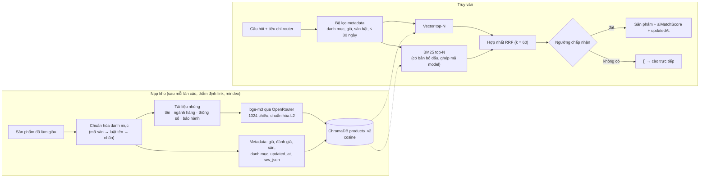

# RAG sản phẩm — truy xuất lai bge-m3 + BM25

> Mã: `backend/services/rag/`, `backend/services/catalog/categories.py` · Script: `backend/scripts/rag/reindex.py`, `eval_rag.py` · Test: `backend/tests/test_rag.py`

| Tệp trong `services/rag/` | Trách nhiệm |
|---|---|
| `service.py` | `ProductRAGService`: nạp kho, truy xuất lai, dọn kho; instance dùng chung `rag_service` xuất ở `__init__.py` |
| `embeddings.py` | `APIEmbeddings`: gọi bge-m3 qua API, chia lô, timeout, cache truy vấn |
| `documents.py` | Sản phẩm → tài liệu nhúng + metadata, và ngược lại |
| `filters.py` | `SearchFilters`: một định nghĩa sinh cả `where` của ChromaDB lẫn hàm lọc cho BM25 |
| `bm25.py`, `text.py` | Chỉ mục BM25, tách từ (bỏ dấu, ghép mã model) |
| `scoring.py` | `Candidate`, `Thresholds` (ngưỡng chấp nhận, điểm khớp) |
| `evaluation.py` | recall@k / MRR, `evaluate_service()` |

RAG trong hệ thống là **tầng thứ hai của tìm kiếm cache-first** (SQLite 2 giờ → **RAG** → cào trực tiếp). Nó trả về sản phẩm đã thu thập trước đó khi đủ liên quan, để khỏi cào lại; kết quả vẫn qua bộ lọc ngữ nghĩa LLM rồi mới xếp hạng. Tra cứu chính sách đổi trả bằng RAG **chưa làm** (để sau).

## 1. Pipeline



| Bước | Cách làm | Lý do |
|---|---|---|
| Embedding | `baai/bge-m3` qua `POST /embeddings` của OpenRouter (dùng lại `OPENROUTER_API_KEY`), chia lô 64, timeout 20 s khi nạp và 8 s khi truy vấn, thử lại 1 lần, cache 512 câu truy vấn trong RAM | Mô hình mặc định cũ (all-MiniLM-L6-v2) chỉ hiểu tiếng Anh: "tai nghe chống ồn" ra chảo chống dính |
| Tài liệu nhúng | Chỉ tên, ngành hàng, thông số (≤ 1.500 ký tự), bảo hành | Giá / đánh giá thay đổi liên tục và làm nhiễu độ tương đồng; chúng nằm ở metadata để lọc |
| Danh mục | `categorize(product)`, xem mục 1.1 | Crawler từng gắn danh mục theo câu hỏi (tìm "laptop" trên Tiki ra băng vệ sinh cũng gắn `laptop`), lẫn `laptop` / `laptops`, 55% là `all`; bộ lọc danh mục chỉ có ích khi nhãn đúng |
| BM25 | Okapi (k1 = 1,5, b = 0,75) trên toàn bộ tài liệu; token gồm từ gốc, bản bỏ dấu và cặp ghép có chữ số (`rtx 3050` → `rtx3050`, `9 kg` → `9kg`) | Khớp mã model và thông số mà vector dễ bỏ qua; gõ không dấu vẫn tìm được |
| Hợp nhất | Reciprocal Rank Fusion, cộng `1 / (60 + hạng)` của hai danh sách | Không cần chuẩn hóa thang điểm khác nhau |
| Ngưỡng | `Thresholds`: nhận nếu khoảng cách ≤ 0,45; hoặc ≤ 0,50 và ≥ 67% từ khóa có trong tài liệu; hoặc có đủ mọi từ khóa | Hiệu chỉnh bằng `eval_rag.py --calibrate` |
| Độ mới | Bỏ qua bản nạp quá `RAG_MAX_AGE_DAYS` (30) ngày và sàn đã bỏ (Shopee / Lazada); `prune()` xóa hẳn khi reindex | Giá cũ dễ sai; Shopee chỉ để lại bản ghi rác |
| Dự phòng | Embedding API lỗi → chỉ BM25 với ngưỡng chặt (≥ 75% từ khóa), tạm ngừng gọi API 60 s; nạp kho bỏ qua (không lưu vector rỗng) | Không làm hỏng lượt tư vấn; không có gì đạt thì cào trực tiếp |

### 1.1 Chuẩn hóa danh mục

`services/catalog/categories.py` chỉ dựa vào mã danh mục của chính sàn:

- Tiki: `primary_category_path` của API tìm kiếm, hoặc `breadcrumbs` của API chi tiết (ví dụ `1/2/1815/8215` = Thiết bị số › Tai nghe & loa). `TIKI_CATEGORY_MAP` tra từ mã sâu nhất trở lên, mã được lưu ở cột `products.source_category_path`.
- TGDĐ / ĐMX: slug danh mục đầu URL (`/dtdd/`, `/may-giat/`, `/op-lung-flipcover/`…), theo `MWG_SLUG_PREFIXES`.

Không có mã hoặc mã chưa có trong bảng thì xếp `other`, không đoán từ tên hay nhãn cũ. Hệ quả đã chấp nhận: phụ kiện người bán đăng nhầm vào mục máy sẽ mang danh mục của máy, nên có thể bị loại vì thấp hơn giá sàn. Sản phẩm cũ thiếu mã được bổ sung bằng `python -m scripts.catalog.backfill_categories`.

`search()` là I/O đồng bộ (gọi HTTP) nên `EcomSearchTool` và `UrlExtractorTool` gọi qua `asyncio.to_thread`.

## 2. Cấu hình

| Biến | Mặc định | Ý nghĩa |
|---|---|---|
| `EMBEDDING_MODEL` | `baai/bge-m3` | Mô hình embedding |
| `EMBEDDING_API_KEY`, `EMBEDDING_BASE_URL` | trống → dùng `OPENROUTER_*` | Nhà cung cấp tương thích OpenAI khác |
| `EMBEDDING_TIMEOUT_SECONDS` / `EMBEDDING_QUERY_TIMEOUT_SECONDS` | 20 / 8 | Timeout khi nạp / khi truy vấn |
| `RAG_COLLECTION` | `products_v2` | Đổi mô hình embedding thì đổi tên collection và reindex |
| `RAG_MAX_AGE_DAYS` | 30 | Hạn dùng của bản ghi trong kho |

Nạp lại kho: `cd backend && python -m scripts.rag.reindex` lấy `raw_json` của `products_v1` cùng bảng `products`, bỏ trùng theo URL (giữ bản mới, giữ thông số làm giàu và mã danh mục sàn từ bản cũ), bổ sung mã danh mục cho sản phẩm Tiki cũ qua API chi tiết (`--no-backfill` để bỏ qua), bỏ bản rác / sàn tắt / quá cũ, giữ nguyên `updated_at`. Lần chạy ngày 29/10/2026: 486 bản ghi → 202 sản phẩm, 19 giây. `products_v1` vẫn còn trên đĩa để so sánh.

## 3. Đánh giá

Bộ truy vấn `backend/tests/fixtures/rag_eval_set.json`: **43 truy vấn có đáp án + 8 truy vấn kho không có hàng** (máy lạnh, đồng hồ thông minh, son môi…), kèm danh mục mà router sẽ trích ra. Nhãn là luật regex trên tên / URL, nên tự áp dụng cho mọi sản phẩm trong kho; bản ghi trùng gộp theo URL.

```bash
cd backend
python -m scripts.rag.eval               # điểm tổng + từng truy vấn
python -m scripts.rag.eval --calibrate   # dò ngưỡng
RUN_LIVE_TESTS=1 pytest tests/test_rag.py -k live
```

| Chỉ số (29/10/2026) | Cũ: all-MiniLM, `products_v1` | Mới: bge-m3 + BM25, `products_v2` |
|---|---|---|
| hit@1 | 0,419 | **0,837** |
| hit@5 | 0,512 | **0,930** |
| recall@5 | 0,280 | **0,878** |
| precision@5 | 0,394 | **0,801** |
| MRR@10 | 0,459 | **0,880** |
| Trả rỗng đúng (truy vấn kho không có) | 0,750 | 0,750 |

Ví dụ: "tai nghe chống ồn" trước ra chảo chống dính, nay ra Sony WH-XB910N, WH-1000XM6, WH-CH730N; "laptop RTX 3050" khớp thông số card rời của LOQ, Victus, Acer Aspire 7 dù tên không có "RTX"; "laptop văn phòng mỏng nhẹ" không còn ra balo / băng vệ sinh "siêu mỏng" nhờ danh mục đã chuẩn hóa.

**Cách đọc kết quả**

- Phần lớn mức tăng đến từ embedding đa ngôn ngữ và danh mục đã chuẩn hóa. Chuyển từ luật tên sang mã sàn gần như không đổi điểm trên kho hiện tại (luật tên vốn khớp gần hết 208 sản phẩm), nhưng đúng hơn với mặt hàng mới. Với kho 202 sản phẩm, 30 ứng viên vector đã phủ gần hết mỗi danh mục nên tắt BM25 (`--mode vector`) cho điểm gần như nhau; BM25 có ích khi kho lớn hoặc khi câu hỏi chứa mã model.
- Câu hỏi mô tả nhu cầu chung ("điện thoại chụp ảnh đẹp pin trâu", "tủ lạnh nhỏ cho phòng trọ", "điện thoại gập") có khoảng cách > 0,5 nên trả rỗng → hệ thống cào trực tiếp. Muốn RAG trả lời được loại này cần viết lại truy vấn bằng LLM (HyDE) hoặc dùng reranker.
- 2/8 truy vấn kho không có vẫn ra kết quả: "máy lạnh inverter" ra tủ lạnh Inverter, "bàn phím cơ" ra laptop gaming. Bộ lọc ngữ nghĩa LLM phía sau loại các kết quả này rồi cào trực tiếp.
- Ngưỡng hiệu chỉnh trên chính bộ đánh giá (51 truy vấn) nên có thể khớp quá mức; cần thêm truy vấn khi kho lớn lên.
- Mỗi truy vấn tốn thêm 1,5–5 giây gọi embedding API (truy vấn lặp lại dùng cache); vẫn nhanh hơn nhiều so với cào trực tiếp (10–20 giây).

## 4. Chưa làm

- RAG cho chính sách bảo hành / đổi trả.
- Reranker (cross-encoder) và viết lại truy vấn bằng LLM cho câu hỏi mô tả nhu cầu.
- Cập nhật lại vector khi giá thay đổi lúc kiểm tra theo dõi giá (hiện chỉ cập nhật khi cào lại).
