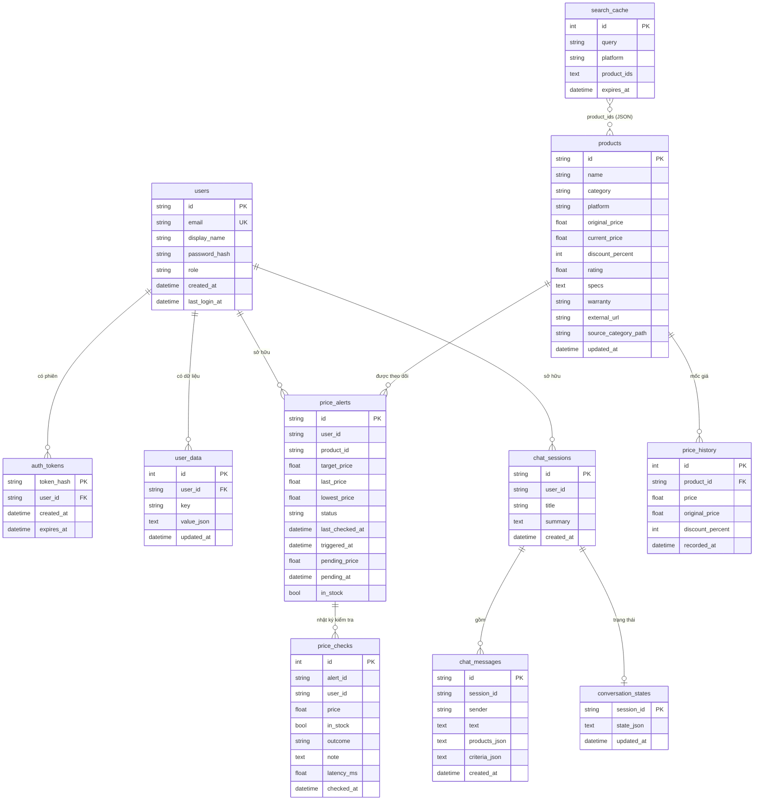

# Sơ đồ dữ liệu

> Nguồn: `backend/database/models/*.py`. Mô tả cột và quy tắc: [05-data-model.md](05-data-model.md).

## Quan hệ giữa các bảng

## Giá trị liệt kê

| Cột | Giá trị |
|---|---|
| `users.role` | `user`, `admin` |
| `price_alerts.status` | `watching`, `triggered` |
| `chat_messages.sender` | `user`, `ai` |
| `products.platform` | `tgdd`, `dmx`, `tiki` |
| `user_data.key` | `conversations`, `saved-products`, `activities`, `search-history` |

## Ràng buộc bảo mật

- `auth_tokens` chỉ chứa SHA-256 của token; lộ CSDL không lộ token dùng được.
- `chat_sessions.user_id` và `price_alerts.user_id` được kiểm tra ở mọi API đọc / ghi.
- Khóa ngoại khai báo `ON DELETE CASCADE` (`auth_tokens`, `user_data`, `price_history`), nhưng SQLite chỉ thực thi khi bật `PRAGMA foreign_keys` (hiện chưa bật). V1 chưa có chức năng xóa tài khoản hay sản phẩm; xóa hội thoại thì `ChatRepository.clear_session` xóa tường minh tin nhắn và trạng thái của phiên.
