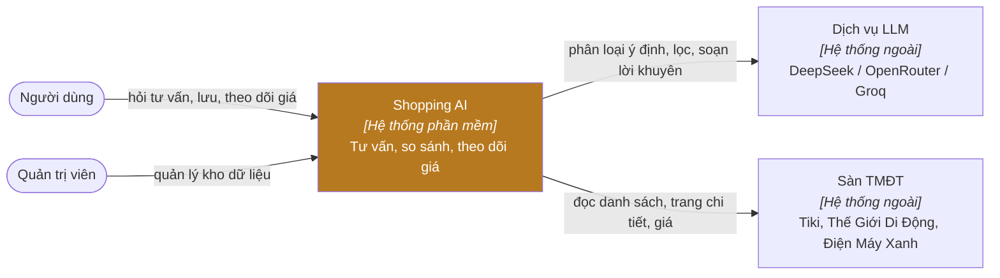

# 3. Bối cảnh và phạm vi

## 3.1 Bối cảnh nghiệp vụ — C4 mức 1

## 3.2 Phạm vi nghiệp vụ

| Trong hệ thống | Ngoài hệ thống |
|---|---|
| Hiểu yêu cầu, hỏi làm rõ, tìm, kiểm chứng, xếp hạng, so sánh, tư vấn | Đặt hàng, thanh toán, vận chuyển |
| Kho sản phẩm, lịch sử giá, theo dõi giá | Giá / tồn kho chính thức (thuộc sàn) |
| Tài khoản, hội thoại, dữ liệu cá nhân | Danh tính bên thứ ba (Google, Facebook) |

## 3.3 Giao diện nghiệp vụ

| Đối tác | Vào | Ra |
|---|---|---|
| Người dùng | Câu hỏi, câu trả lời làm rõ, thao tác lưu / theo dõi | Sản phẩm xếp hạng + lý do, bảng so sánh, lời khuyên, trạng thái giá |
| Dịch vụ LLM | Prompt (yêu cầu, ngữ cảnh chuẩn hóa) | JSON ý định / tiêu chí; danh sách giữ / loại; lời tư vấn (stream) |
| Sàn TMĐT | Yêu cầu HTTP (trang danh mục, trang chi tiết, API Tiki) | HTML / JSON sản phẩm, thông số, giá, chính sách |

## 3.4 Bối cảnh kỹ thuật

| Kênh | Giao thức | Ghi chú |
|---|---|---|
| Trình duyệt ↔ Backend | HTTPS (cục bộ: HTTP) JSON + SSE, Bearer token | CORS giới hạn theo `CORS_ORIGINS` |
| Backend ↔ LLM | HTTPS, API tương thích OpenAI | Timeout 45 s, 1 lần thử lại, chuỗi dự phòng |
| Backend ↔ Tiki | HTTPS JSON (`/api/v2/products`) | Lọc theo mã danh mục |
| Backend ↔ TGDĐ/ĐMX | HTTPS HTML (Next.js render sẵn) | Thử lại khi lỗi kết nối; JSON-LD cho giá |

## 3.5 Ranh giới trạng thái

- Dữ liệu sản phẩm là **bản sao có thời hạn** của dữ liệu sàn (cache 2 giờ, trang chi tiết 6 giờ, làm ấm khi cũ > 12 giờ).
- Chính sách đổi trả ở màn tra cứu là dữ liệu tham khảo, không phải dữ liệu sàn tại thời điểm xem.
