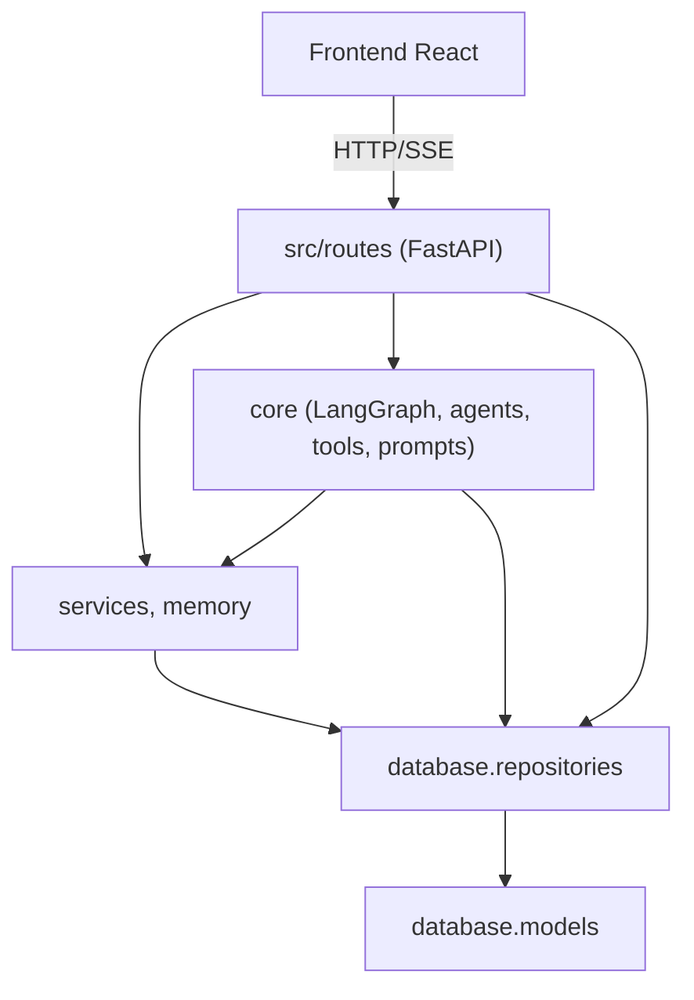

# 4. Chiến lược giải pháp

## 4.1 Chiến lược trong một câu

LLM chỉ **hiểu yêu cầu và diễn đạt**; còn **dữ liệu, kiểm chứng và xếp hạng** do công cụ và thuật toán xác định, được điều phối bởi một đồ thị trạng thái LangGraph và trình bày minh bạch qua stream.

## 4.2 Ánh xạ mục tiêu → giải pháp

| Mục tiêu chất lượng | Giải pháp |
|---|---|
| Trung thực dữ liệu | Advisor chỉ nhận ngữ cảnh chuẩn hóa từ dữ liệu thu thập; đối chiếu thông số với trang chi tiết; `search_notes` cho mọi điểm chưa chắc; nới lỏng có ghi lại |
| Bảo mật & riêng tư | Token Bearer băm SHA-256, bcrypt, `require_user` / `require_admin`, lọc theo `user_id` ở repository |
| Phản hồi nhanh | Cache-first (SQLite → ChromaDB → cào), cào song song, cache trang chi tiết, SSE gửi từng phần |
| Bền vững | `with_fallbacks` cho LLM, câu trả lời dựng sẵn, thử lại khi lỗi mạng, guardrails giá |
| Dễ bảo trì | Phân tầng một chiều; bộ phân tích HTML không phụ thuộc tên class; fixture trang thật cho test hồi quy |

## 4.3 Hướng phụ thuộc

## 4.4 Lựa chọn công nghệ chính

| Vấn đề | Lựa chọn | Lý do |
|---|---|---|
| Điều phối nhiều bước có rẽ nhánh | LangGraph `StateGraph` | Một đồ thị cho cả gọi một lần và stream; node phát sự kiện qua `get_stream_writer` |
| LLM | DeepSeek (chính), OpenRouter, Groq | Giá rẻ, API tương thích OpenAI, dễ dự phòng |
| Tìm theo ngữ nghĩa | ChromaDB nhúng + embedding bge-m3 qua API + BM25 (RRF) | Không cần dịch vụ CSDL riêng; hiểu tiếng Việt; khớp mã model |
| Lưu trữ | SQLite + SQLAlchemy async | Không cần cài CSDL; đủ cho tải đồ án |
| Stream | SSE (`sse-starlette`) | Một chiều server → client, đơn giản hơn WebSocket |
| Giao diện | React 19 + Tailwind 4 | Chế độ tối bằng định nghĩa lại biến màu |

Chi tiết từng quyết định: [09-architecture-decisions.md](09-architecture-decisions.md).
