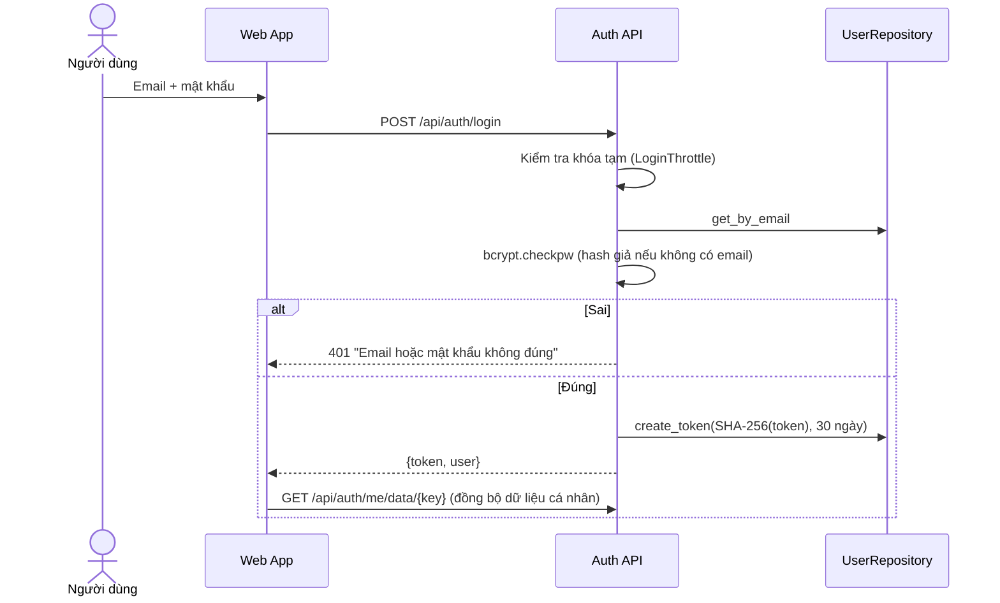
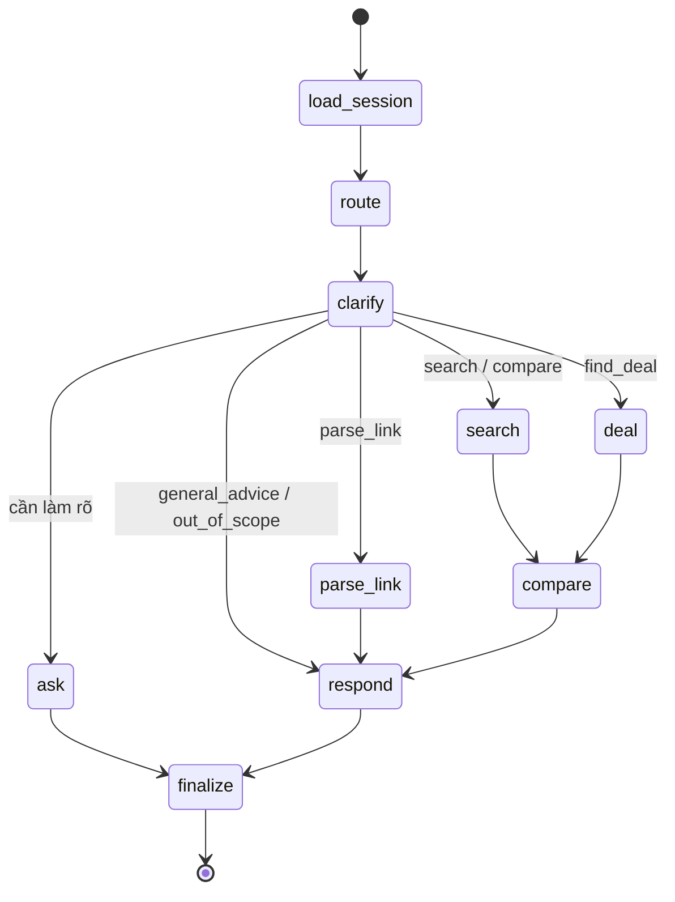
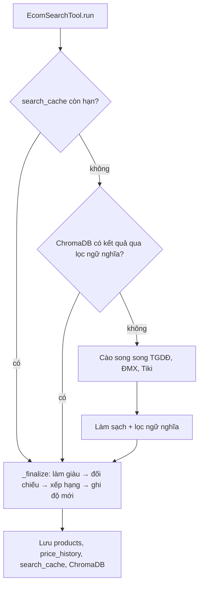
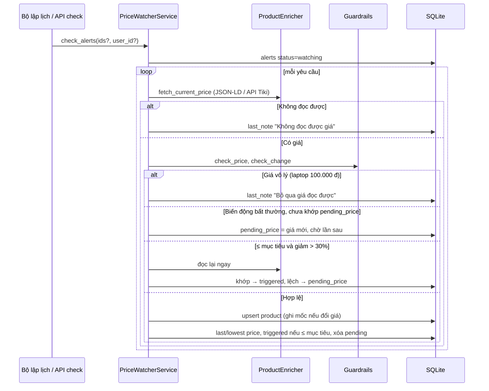

# 6. Góc nhìn thời gian chạy

## 6.1 Đăng nhập

## 6.2 Tư vấn mua sắm (đồ thị LangGraph)

Trình tự một lượt tìm mua: xem [UML trình tự §2](../uml/02-sequence-diagrams.md#2-tư-vấn-mua-sắm--post-apichatstream). Điểm chính:

1. `_own_session` gắn / kiểm tra chủ hội thoại (`403` nếu của người khác).
2. Node `route`: gọi LLM một lần lấy JSON `{intent, criteria}`; áp `platform` từ giao diện.
3. Node `search` (`_run_search`): `EcomSearchTool.run` → nếu rỗng thì nới lỏng; nếu không sản phẩm nào đúng thông số thì tìm thêm +20% ngân sách.
4. Mỗi node phát sự kiện qua `get_stream_writer()`; route SSE chuyển thẳng sang trình duyệt.

## 6.3 Tìm kiếm cache-first

## 6.4 Theo dõi giá

## 6.5 Lỗi thường gặp

| Tình huống | Hành vi |
|---|---|
| Token sai / hết hạn | `401`; giao diện phát sự kiện `shopping-ai:auth-expired` và về màn đăng nhập |
| LLM lỗi | Chuyển nhà cung cấp kế tiếp; tất cả lỗi → phân loại từ khóa / câu trả lời dựng sẵn |
| Sàn lỗi kết nối | Thử lại; nguồn khác vẫn trả kết quả; ghi chú cho người dùng |
| Lỗi trong stream | Sự kiện `error`; giao diện giữ phần đã nhận và hiện thông báo |
| Backend tắt | Giao diện hiện địa chỉ backend và lệnh khởi động |
