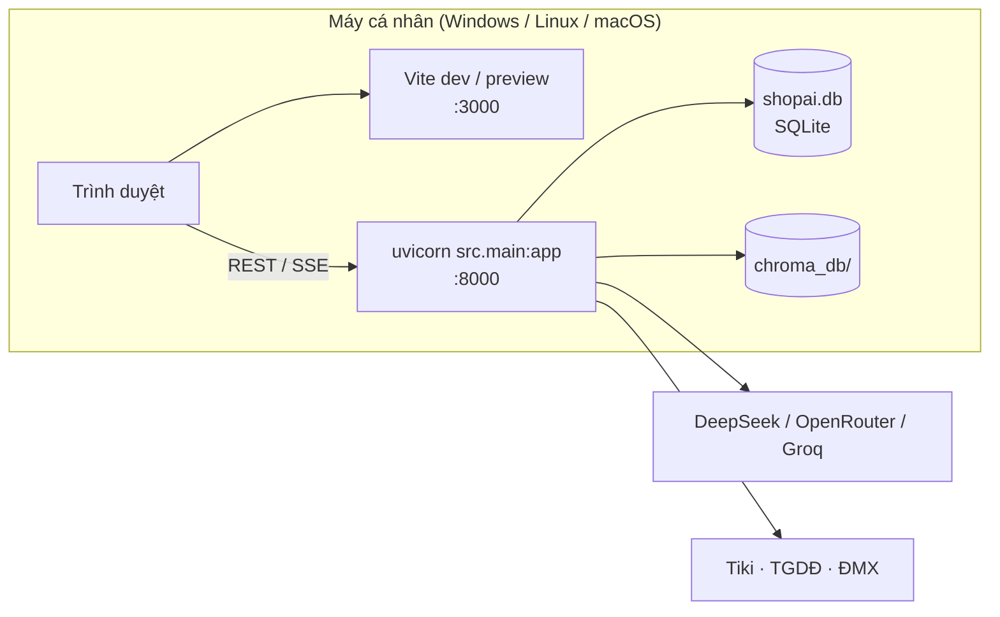
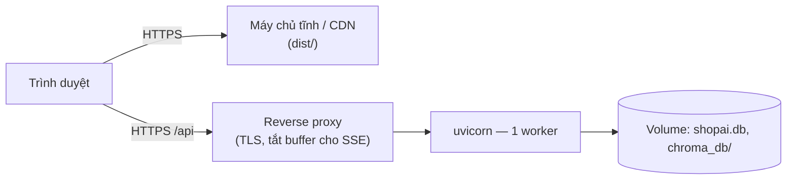

# 7. Góc nhìn triển khai

## 7.1 Hiện tại — chạy cục bộ

| Thành phần | Lệnh |
|---|---|
| Backend | `cd backend && uvicorn src.main:app --port 8000` |
| Frontend (phát triển) | `cd frontend && npm run dev` → `http://localhost:3000` |
| Frontend (bản build) | `npm run build` → `dist/` phục vụ bằng máy chủ tĩnh bất kỳ |

## 7.2 Triển khai mục tiêu (gợi ý)

## 7.3 Ánh xạ container → nút

| Container | Nút | Ghi chú |
|---|---|---|
| Web App | Máy chủ tĩnh | Đặt `VITE_API_BASE_URL` lúc build |
| Backend | Máy chủ ứng dụng | **Một worker**: bộ đếm đăng nhập sai và bộ nhớ đệm hội thoại nằm trong RAM tiến trình |
| SQLite, ChromaDB | Ổ đĩa của máy chủ ứng dụng | Sao lưu định kỳ |

## 7.4 Yêu cầu triển khai

- Python 3.11, Node ≥ 20.11; RAM ≥ 2 GB (embedding gọi qua API, không chạy mô hình cục bộ); cần ra Internet tới OpenRouter.
- `backend/.env`: ít nhất một khóa LLM; `CORS_ORIGINS` gồm địa chỉ frontend; `ADMIN_EMAILS`.
- Reverse proxy không đệm phản hồi SSE (`/api/chat/stream`).
- Muốn chạy nhiều worker: chuyển PostgreSQL và đưa bộ đếm đăng nhập sai / bộ nhớ đệm hội thoại ra kho dùng chung.
