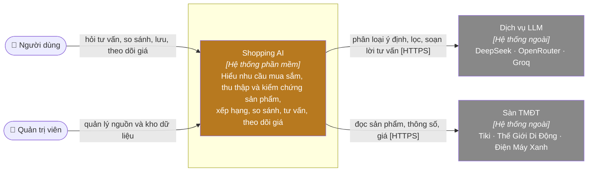

# C1 — Bối cảnh hệ thống

> **Mục đích:** cho thấy ai dùng Shopping AI và hệ thống phụ thuộc những hệ thống ngoài nào, chưa đi vào công nghệ.

## Ranh giới hệ thống

Shopping AI chịu trách nhiệm: tài khoản, hội thoại tư vấn, thu thập và kiểm chứng dữ liệu sản phẩm, xếp hạng, so sánh, săn deal, theo dõi giá, dữ liệu cá nhân.

Ngoài phạm vi: đặt hàng, thanh toán, vận chuyển, giá / tồn kho chính thức (thuộc sàn), danh tính bên thứ ba.

## Người dùng và quyền chính

| Người | Quyền chính |
|---|---|
| Người dùng | Mọi chức năng tư vấn và dữ liệu cá nhân của mình |
| Quản trị viên | Như người dùng + kích hoạt thu thập dữ liệu, xem nhật ký guardrails |

**Tiếp theo:** [C2 — Container](02-container.md).

**Nguồn:** `backend/src/main.py`, `backend/src/config.py`, [01-scope.md](../../01-scope.md).
