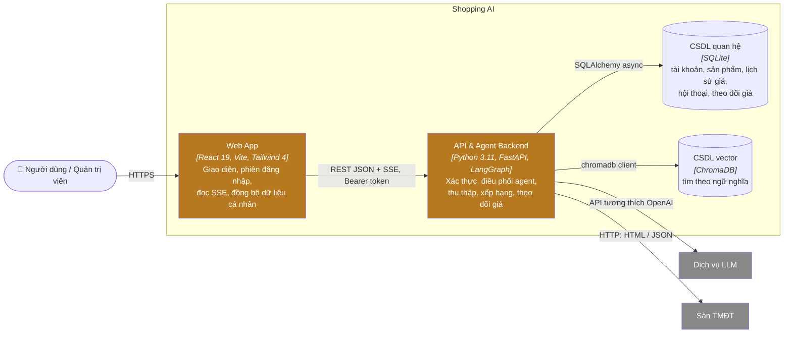

# C2 — Container

## Trách nhiệm

| Container | Trách nhiệm | Mã |
|---|---|---|
| Web App | Màn hình, hộp thoại; gọi API qua `agentApi.ts`; giữ token; đồng bộ dữ liệu cá nhân (`useSyncedState`) | `frontend/` |
| API & Agent Backend | Mọi quy tắc nghiệp vụ, xác thực, phân quyền; đồ thị LangGraph; vòng theo dõi giá và làm ấm kho chạy nền trong cùng tiến trình | `backend/` |
| CSDL quan hệ | Dữ liệu bền vững | `backend/shopai.db` |
| CSDL vector | Vector mô tả sản phẩm | `backend/chroma_db/` |

## Quy tắc kiến trúc

- Web App không chứa quy tắc nghiệp vụ quyết định; backend luôn kiểm tra lại.
- Chỉ backend giữ khóa API LLM và gọi sàn TMĐT.
- Tác vụ nền (theo dõi giá, làm ấm kho) chạy trong lifespan của backend, không tách dịch vụ riêng.

## Hiện trạng

Hai container chạy cục bộ (`:3000`, `:8000`); xem [arc42 §7](../arc42/07-deployment-view.md).

**Tiếp theo:** [C3 — Thành phần](03-component.md).
