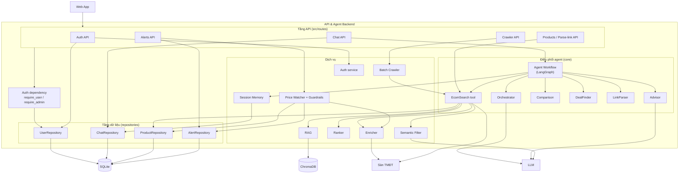

# C3 — Thành phần backend

## Danh mục thành phần

| Thành phần | Trách nhiệm | Phụ thuộc chính |
|---|---|---|
| Auth API + Auth service | Đăng ký, đăng nhập, phiên, hồ sơ, dữ liệu cá nhân | UserRepository |
| Auth dependency | Xác định người dùng từ token, kiểm tra vai trò | UserRepository |
| Chat API | Quyền sở hữu hội thoại, gọi workflow, chuyển sự kiện SSE | Agent Workflow, ChatRepository |
| Agent Workflow | Đồ thị LangGraph; hỏi làm rõ; tìm kiếm có nới lỏng / tìm thêm; gợi ý câu hỏi | Orchestrator, EcomSearch, Comparison, Advisor, DealFinder, LinkParser, Session Memory |
| Orchestrator | Ý định + tiêu chí | LLM |
| EcomSearch | Cache → RAG → cào; làm sạch; lọc; hoàn thiện | Enricher, Ranker, Semantic Filter, RAG, ProductRepository, sàn |
| Enricher | Trang chi tiết, giá hiện tại | sàn |
| Ranker | Đối chiếu thông số, điểm, lý do | — |
| Comparison | Bảng so sánh | — |
| Advisor | Ngữ cảnh chuẩn hóa, lời tư vấn | LLM, Session Memory |
| Price Watcher | Theo dõi giá, guardrails | Enricher, AlertRepository, ProductRepository |
| Batch Crawler | Làm ấm / thu thập hàng loạt | EcomSearch |
| Session Memory | Trí nhớ hội thoại, trạng thái giữa các lượt | ChatRepository |

## Luồng phụ thuộc

Route → (dependency xác thực) → agent / dịch vụ → repository → SQLite. Không thành phần nào ở tầng dưới gọi ngược lên route.

**Tiếp theo:** [C4 — Mã](04-code.md).
