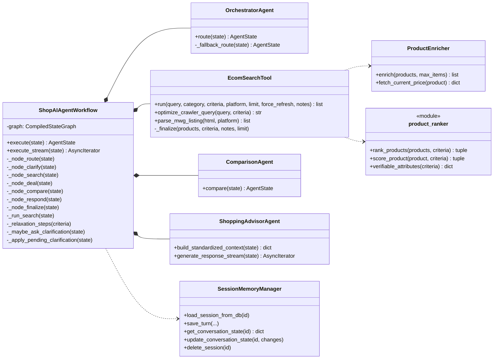
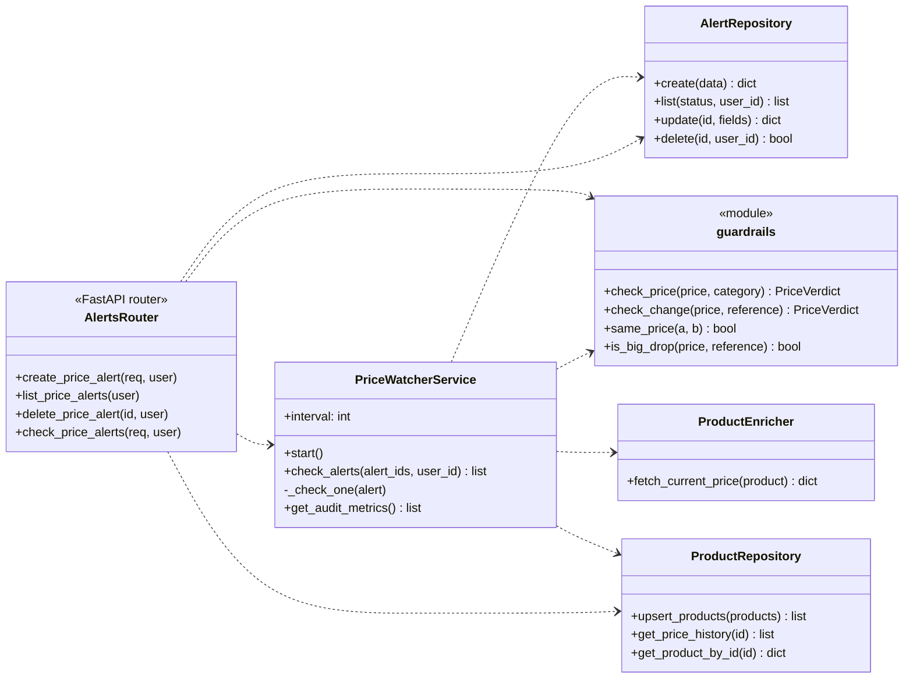

# C4 mức 4 — Mã của hai luồng cốt lõi

## L4.1 Tư vấn mua sắm

## L4.2 Theo dõi giá

## Quy tắc chung cho cả hai luồng

- Node / dịch vụ không ném lỗi của hệ thống ngoài ra ngoài; ghi vào `search_notes` hoặc `last_note`.
- Mọi truy vấn dữ liệu cá nhân lọc theo `user_id` của người gọi.
- Trạng thái một lượt tư vấn nằm trong `AgentState`; trạng thái bền nằm trong SQLite (`conversation_states`, `price_alerts`). Singleton `session_memory` chỉ là bộ nhớ đệm RAM của các bảng hội thoại (lý do chỉ chạy một worker).

Chi tiết lớp và trình tự: [UML](../uml/README.md).
