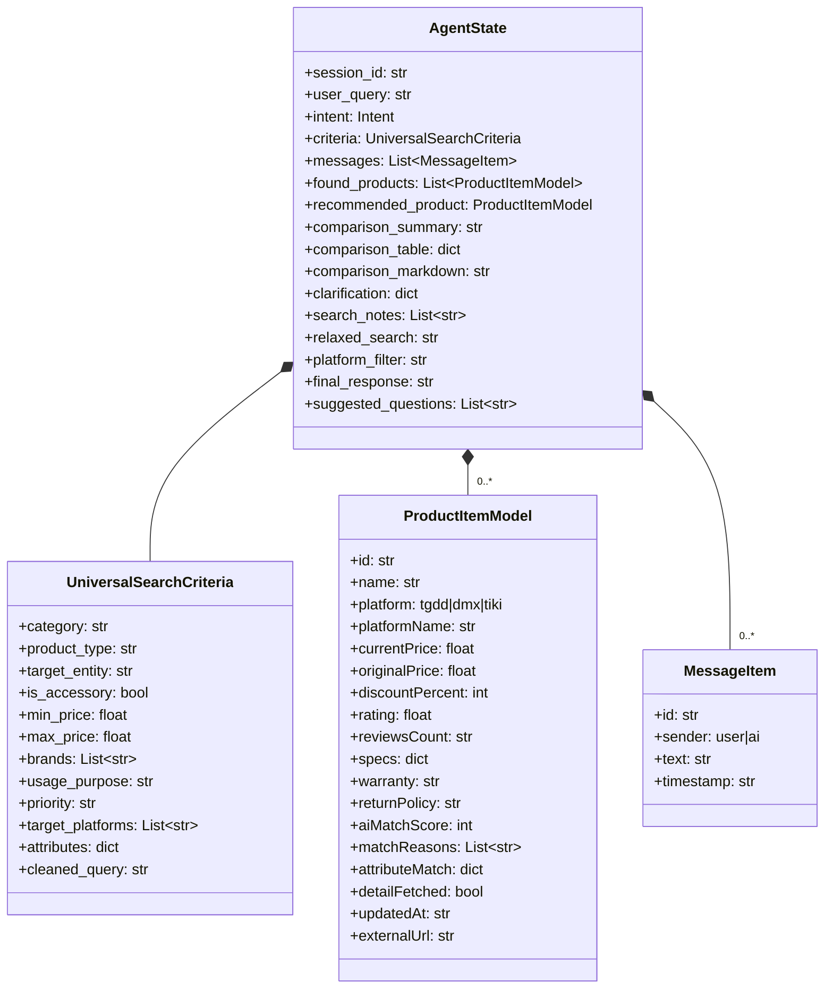
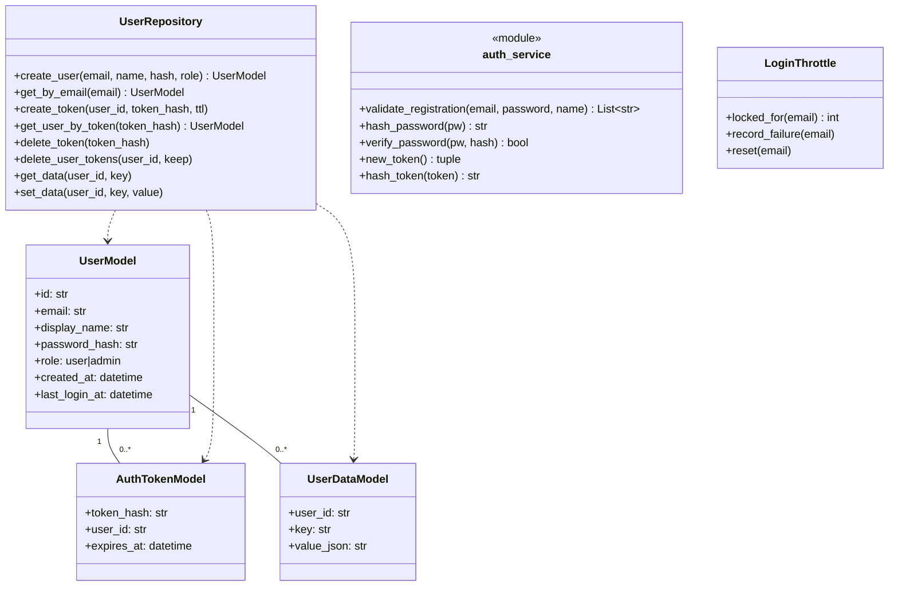
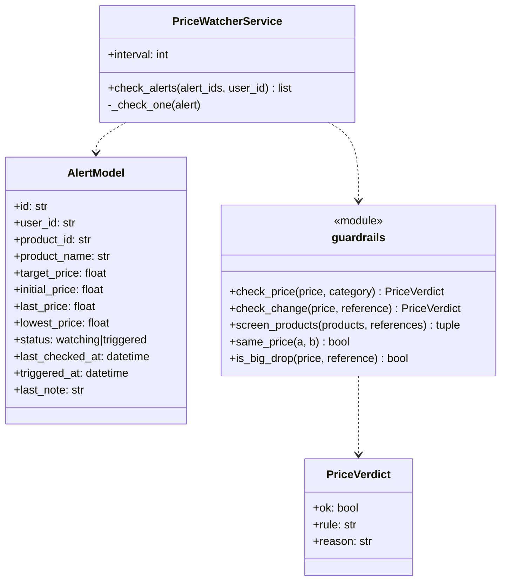
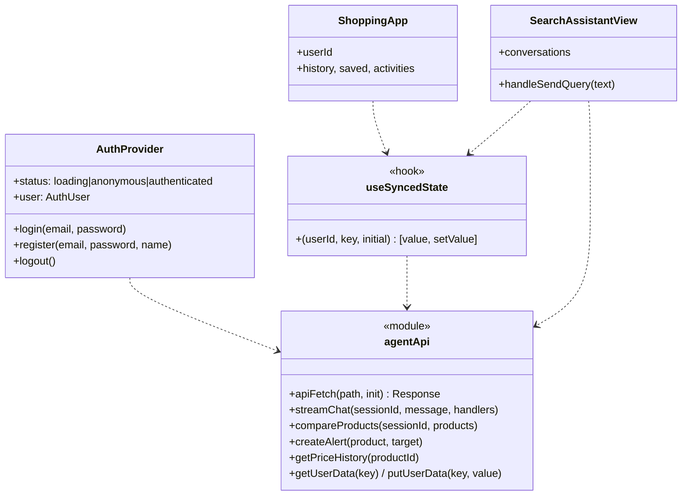

# Biểu đồ lớp

## 1. Trạng thái agent (`backend/core/state.py`)

## 2. Tài khoản và xác thực

## 3. Theo dõi giá

## 4. Frontend (`frontend/src`)

## 5. Quy ước DTO

- Dữ liệu sản phẩm / theo dõi giá trả về `camelCase` (`currentPrice`, `targetPrice`).
- Body yêu cầu dùng `snake_case` (`target_price`, `display_name`, `session_id`).
- Lỗi luôn `{"detail": str}`.
