# Biểu đồ trình tự

## 1. Đăng ký — `POST /api/auth/register`

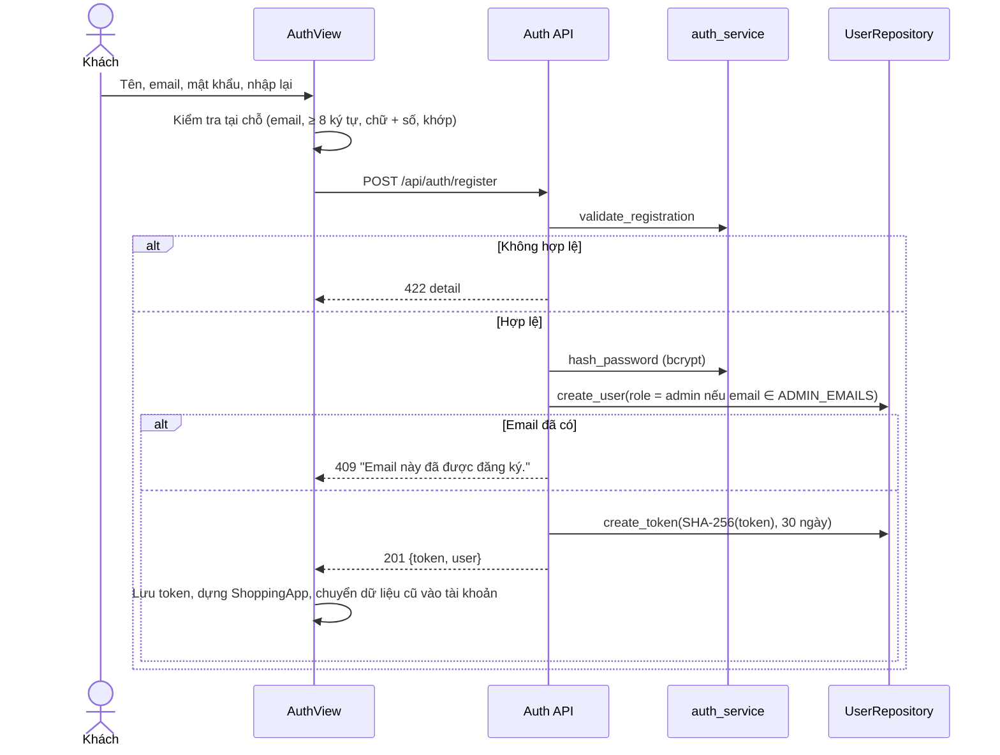

## 2. Tư vấn mua sắm — `POST /api/chat/stream`

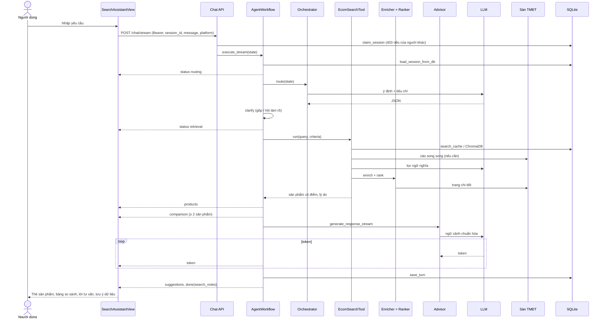

## 3. Hỏi làm rõ qua hai lượt

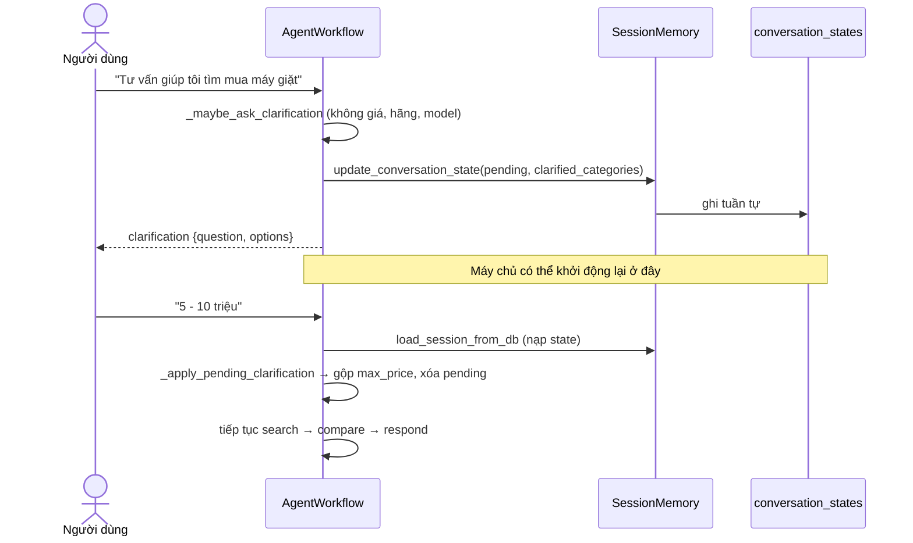

## 4. Kiểm tra giá — `POST /api/alerts/check`

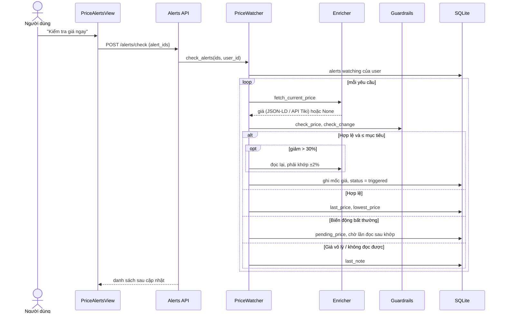

## 5. Xóa hội thoại — `DELETE /api/chat/history/{id}`

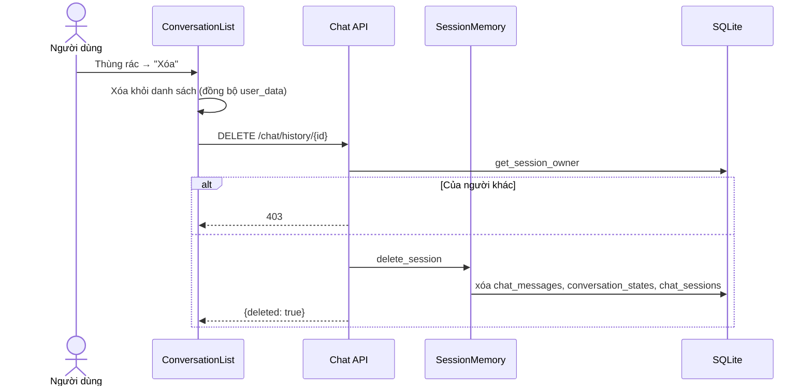

## 6. Đăng xuất — `POST /api/auth/logout`

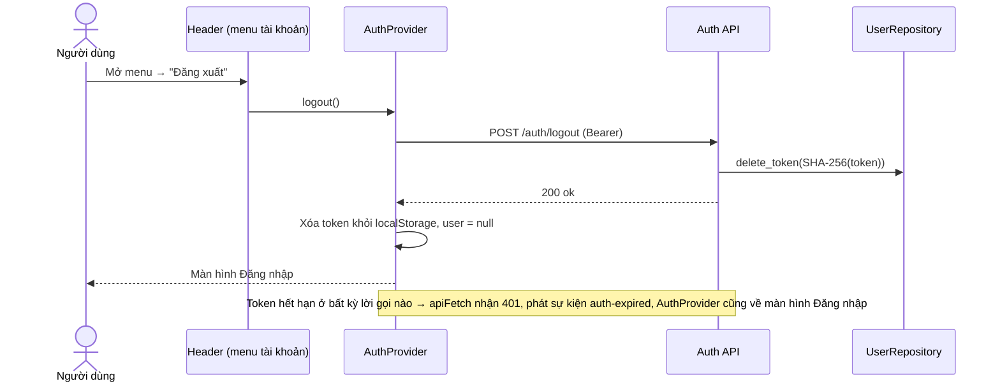

## 7. Đổi mật khẩu — `POST /api/auth/change-password`

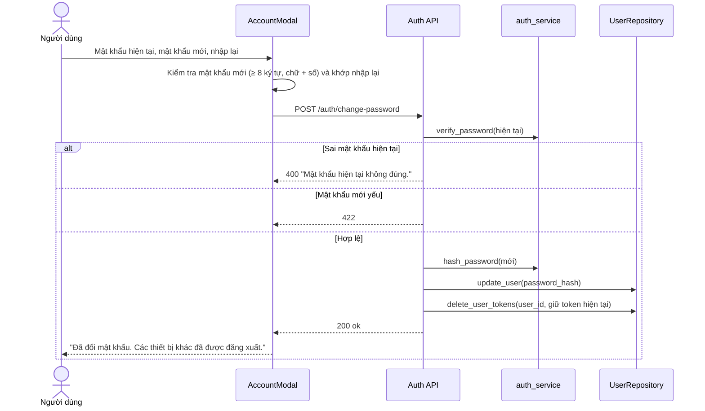

## 8. Nhờ AI so sánh sản phẩm đã lưu — `POST /api/chat/compare`

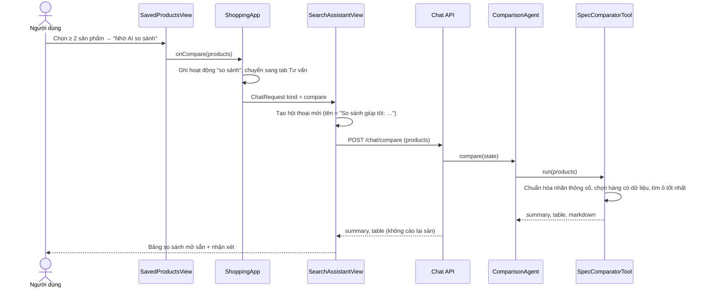

## 9. Thẩm định link sản phẩm

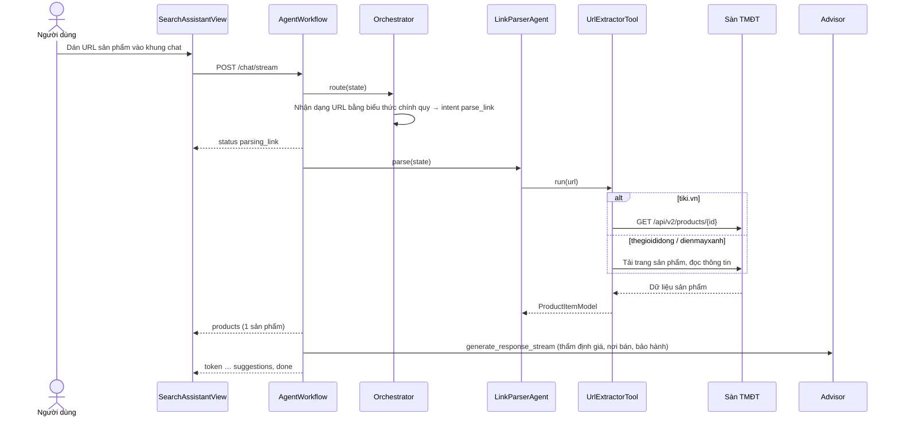

## 10. Săn deal

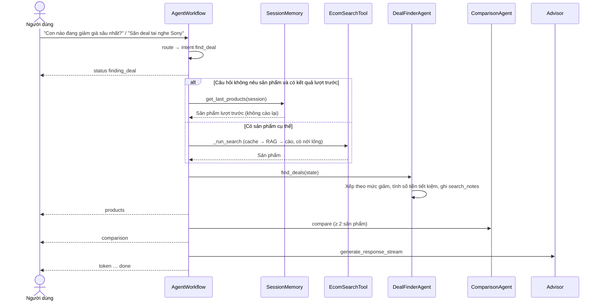

## 11. Tạo và chuyển hội thoại

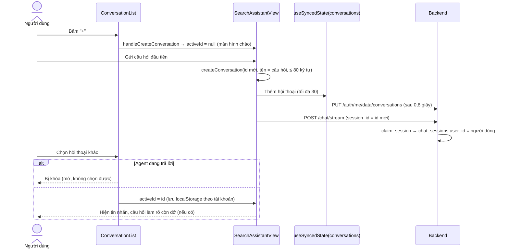

## 12. Lưu sản phẩm và đồng bộ dữ liệu cá nhân

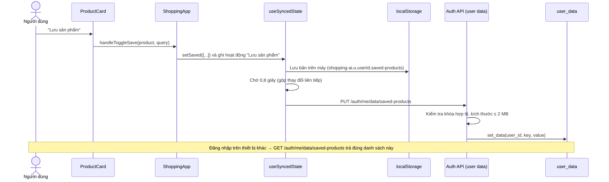

## 13. Tạo yêu cầu theo dõi giá — `POST /api/alerts`

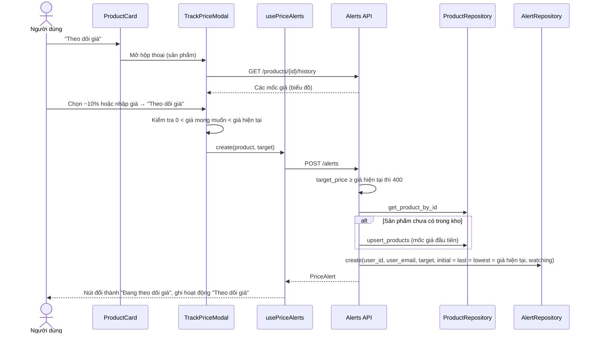

## 14. Xem lịch sử giá — `GET /api/products/{id}/history`

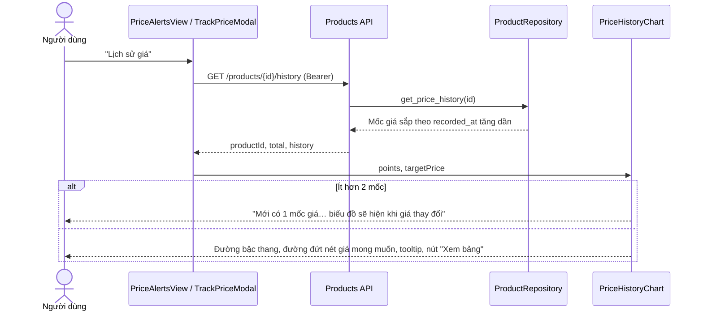

## 15. Tra cứu chính sách bảo hành & đổi trả

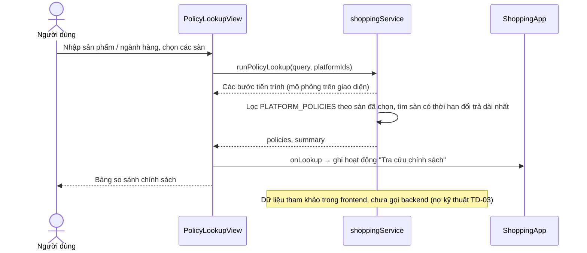

## 16. Thu thập dữ liệu hàng loạt — `POST /api/crawler/trigger`

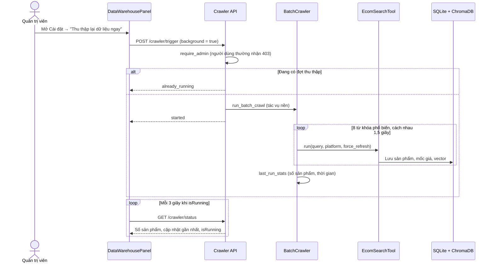

## 17. Quy ước lỗi chung

`401` thiếu / sai token · `403` sai vai trò hoặc không sở hữu hội thoại · `404` không tìm thấy (kể cả không sở hữu yêu cầu theo dõi giá) · `422` dữ liệu không hợp lệ · lỗi trong stream gửi sự kiện `error`.
