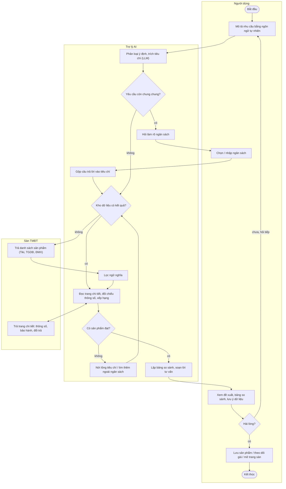
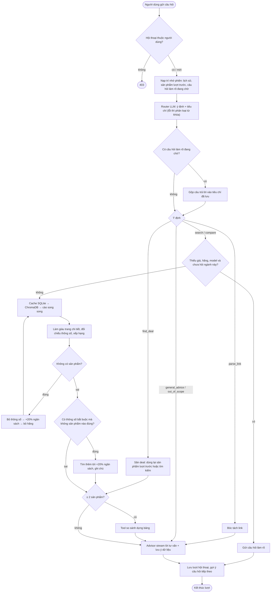
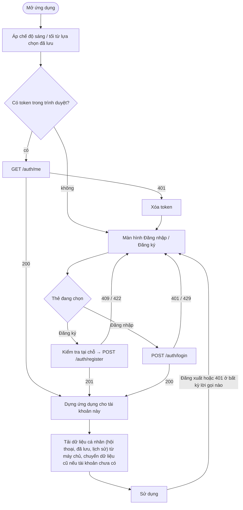
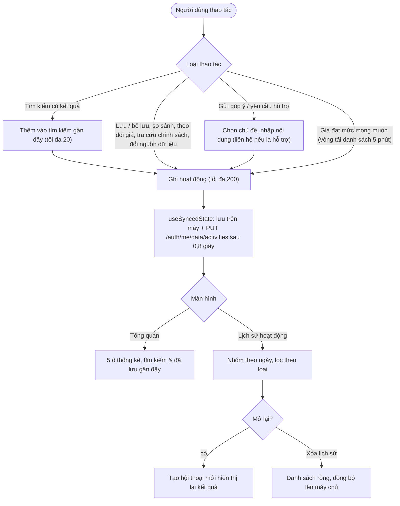

# Biểu đồ hoạt động

## 1. Quy trình nghiệp vụ mua sắm có trợ lý AI

Ba làn: Người dùng, Trợ lý AI, Sàn TMĐT. Trợ lý chỉ cào sàn khi kho dữ liệu không có kết quả phù hợp.

## 2. UC05 — Tư vấn mua sắm (một lượt)

## 3. Khởi động ứng dụng và cổng đăng nhập (UC01–UC03)

## 4. Tổng quan, lịch sử hoạt động, góp ý (UC15, UC18)

